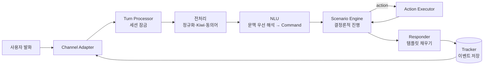

# 챗봇 엔진 코어 — 분석 및 구현 계획 (v2: LLM 없는 시나리오형 코어)

작성: 2026-11-06 · 상태: **초안(결정 대기 1건)**

> 표기: **[확인]** 이번 조사에서 원본(공식 문서·코드·명령 결과)으로 직접 확인 · **[2차]** 블로그·검색 결과 요약 · **[추정]** 실측 전 제안값

---

## 0. 방향과 결정

**확정된 방향 (영기 결정, 2026-11-06)**
- v1 코어에는 **LLM을 쓰지 않는다.** 이해(NLU)·대화 관리·응답을 모두 직접 구현한다.
- 나중에 **빌더**를 만든다. 빌더에서 시나리오와 유사어(동의어·예문)를 등록하고 학습시키면, 챗봇은 시나리오대로 답한다. 코어는 지금부터 이 구조에 맞춰 설계한다.

**남은 결정**

| # | 결정 | 추천 | 대안 | 이유 |
|---|------|------|------|------|
| D1 | 구현 언어 | **Python 3.13+ / FastAPI / Pydantic / scikit-learn / kiwipiepy (uv)** | Kotlin/Spring + Kiwi Java 바인딩 | 한국어 형태소 분석기 Kiwi와 분류기 학습 도구가 Python에서 가장 잘 갖춰져 있다. 머신에 uv·Python이 이미 있다 |

**가정** (틀리면 말해 주세요)
- A1. "LLM 없음"은 **생성형 LLM 없음**이다. 처음에는 신경망 모델도 빼려고 했지만, Phase 0에서 n-gram 방식이 기준(macro-F1 0.90)에 못 미쳐 **문장 임베딩 모델(생성 안 함, 문장 → 벡터)**을 쓰기로 했다 (영기 결정, 2026-11-06).
- A2. 만들 것은 **여러 봇을 올리는 엔진**이다. 기존 기능(날씨·기온·시간·인사 등)은 첫 샘플 봇으로 옮겨 엔진을 검증한다.
- A3. 빌더 UI는 이번 범위가 아니다. 다만 빌더가 쓸 **봇 정의 형식과 학습·배포 API**는 이번 범위에서 정한다.
- A4. 기존 Java 코드는 이 계획이 승인된 뒤 Phase 1에서 지운다. 지금은 손대지 않았다.

---

## 1. 기존 엔진(LASA) 분석

> 기존 코드는 Phase 1에서 지웠다. 아래 파일:줄은 커밋 `4254a8e` 기준이다(`git show 4254a8e:src/main/java/...`).

구조: `Listen(전처리) → Analyze(Rasa NLU + KOMORAN 키워드, 결과 병합) → Solve(intent별 switch) → Answer(템플릿)`. 의도를 모르면 OpenAI로 넘긴다.

| 문제 | 근거 (파일:줄) [확인] | 새 엔진에서의 해결 |
|------|----------------------|---------------------|
| 대화 상태가 없다. "부산은?" 같은 후속 질문을 못 받는다 | `ChatRequest.java:30` — `sessionId` 선언만 있고 아무 데서도 읽지 않음 | 세션별 이벤트 기록(Tracker) + 상태 |
| Rasa는 NLU만 쓰고, 학습시킨 대화 관리(stories·rules·TEDPolicy)는 버려진다 | `RasaClientService.java:47` — `/model/parse`만 호출 | 대화 흐름은 시나리오 엔진이 맡음 |
| 두 분석기 결과를 근거 없는 숫자(+0.1, ×0.9, 임계값 0.7)로 합친다 | `HybridAnalyzer.java` `determineIntent` | 분류기 하나 + 봇별로 조정하는 임계값 |
| 지역 인식이 코드에 박힌 키워드 배열이다. 새 지역은 코드를 고쳐야 넣을 수 있다 | `SimpleSolver.java` `LOCATION_KEYWORDS` | 엔티티 사전(대표값 + 동의어)을 봇 데이터로 |
| 업무 로직·응답 문구·사전이 switch문 하나에 섞여 있다 | `SimpleSolver.java` (298줄) | 시나리오(데이터) / 액션(코드) / 응답 템플릿(데이터)으로 분리 |
| 내부 예외 메시지가 사용자에게 그대로 나간다 | `LasaChatbotService.java:67` | 사용자에겐 고정 문구, 상세 내용은 로그에만 |
| 문서와 실제가 다르다 | README는 `/api/v1/chat`, 컨트롤러는 `/api/chat` | API는 OpenAPI 스키마에서 나오고 테스트로 고정 |
| 테스트가 JSON 파싱 1개 + 컨텍스트 로드 1개뿐이다 | `src/test/` | 대화 테스트 + NLU 평가 리포트 |

**재사용할 자산:** `rasaServer/data/nlu.yml`에 의도 10개, 예문 528개가 있다 [확인, `grep -c`]. 이 데이터를 새 형식으로 옮겨 Phase 0의 학습·평가 데이터로 쓴다.

---

## 2. 챗봇 엔진의 원리 — LLM 없는 시나리오형

### 2.1 고전 파이프라인

`발화 → [NLU] 의도 + 엔티티 → [상태 추적] 지금까지 채워진 값 → [정책] 다음 행동 → [응답 생성] 문장` [2차, arXiv 2311.16789]

- 장점: 단계마다 결과를 눈으로 볼 수 있고, 같은 입력엔 항상 같은 답이 나온다.
- 약점: 앞 단계(NLU)의 실수가 뒤로 퍼진다. 예상 밖 문장은 폴백으로 빠진다.
- 대응: 아래 2.3의 "문맥 우선 해석"과 "애매하면 되묻기"로 줄인다.

### 2.2 빌더형 플랫폼들의 공통 구조

| 개념 | 카카오 i 오픈빌더 [2차] | Dialogflow CX [확인] | Amazon Lex V2 [확인] | Rasa NLU [확인, 기존 `config.yml`] | **우리 엔진** |
|------|------|------|------|------|------|
| 의도 | 블록 + 패턴 발화(예문) | intent + training phrase | intent + sample utterance | intent + examples | `Intent` + 예문 |
| 엔티티 | 엔티티(대표 엔트리 + 동의어) | entity type(값 + synonym) | slot type | entity + `EntitySynonymMapper` | `Entity`(대표값 + 동의어 / 정규식 / 시스템) |
| 대화 흐름 | 시나리오 > 블록 | flow > page | intent + slot 되묻기 | stories / rules | `Scenario` > step |
| 값 수집 | 파라미터(필수 시 되묻기) | form parameter | slot elicitation | slot / form | `collect` step |
| 외부 연동 | 스킬(웹훅) | webhook | Lambda | custom action | `Action`(코드 / 나중에 웹훅) |
| 반영 | 학습 후 **배포** | 버전·환경 | version / alias | 모델 학습·로드 | 초안 → 학습 → **배포 버전** |

- 오픈빌더는 동의어로 엔티티를 인식하면 **대표 엔트리를 최종 값으로** 쓴다 [2차, i.kakao.com 엔티티 도움말 검색 결과]. 우리도 같은 규칙을 쓴다. 예: "부싼", "부산광역시" → `부산`.
- 공통점: 봇 개발자는 **데이터(예문·동의어·시나리오·응답)**만 편집하고, 엔진은 그 데이터를 학습·실행한다. 빌더를 붙이려면 코어가 처음부터 이렇게 나뉘어 있어야 한다.

### 2.3 LLM 없는 NLU의 베스트 프랙티스

1. **정규화 → 형태소 분석 → 동의어 치환 → 특징 추출 → 분류.** 기존 Rasa 설정도 글자 단위 n-gram(char_wb 1~4) + 분류기 + 동의어 매퍼 구조였다 [확인, `rasaServer/config.yml`].
2. **특징은 문장 임베딩, 분류기는 LogisticRegression.** 임베딩 모델은 학습시키지 않고(frozen) 그 위에 선형 분류기만 학습한다. 의도당 예문이 10개 안팎일 때 이 방식이 모델 전체를 학습시키는 것보다 정확하고 안정적이다 [확인, Casanueva et al. 2020, arxiv 2003.04807]. Phase 0 실측 결과는 [확인, `docs/benchmarks/phase0.md`]와 같다.
   - `dragonkue/snowflake-arctic-embed-l-v2.0-ko`(600M, Apache-2.0) + LR(C=10)의 결과(hard negative 추가 후): macro-F1 0.933(임계값 교차 적합), 개발용 범위 밖 거절률 0.96 [95% 구간 0.90~0.98], 학습 2.4초. 지연은 연속 요청 p95 15.5ms지만, 요청 사이에 쉬면 p95 약 25~45ms다(쉬는 시간과 측정 회차에 따라 다름, Phase 5 참고).
   - n-gram 최고 조합과의 차이는 +0.103 [부트스트랩 95% 구간 +0.073~+0.143]으로 우연이 아니다. Qwen3-Embedding과의 차이(+0.007 [−0.019~+0.037])는 구분되지 않는다. arctic을 고른 이유는 Qwen3가 지연 기준(p95 24ms)을 넘기 때문이다.
   - 글자·형태소 n-gram은 같은 유사도 게이트를 붙여도 가장 좋은 조합이 F1 0.829, 거절률 0.68에 그쳤다. 단어 조각만 봐서는 "약국 몇 시까지 해?"와 "지금 몇 시야"를 구분하기 어렵다.
   - n-gram을 임베딩에 더해도 나아지지 않았다(0.924). 그래서 v1은 임베딩만 쓴다.
   - **범위 밖 판정은 두 겹이다.** `out_of_scope` 클래스 확률, 그리고 학습 예문(범위 밖 예문 제외)과의 최대 코사인 유사도가 임계값보다 낮은지를 함께 본다. 두 임계값은 교차검증 예측에서만 고른다(hard negative 추가 후: 확률 0.30, 유사도 0.39).
   - 학습할 때 예문 임베딩을 캐시해 두면, 빌더에서 저장할 때 새로 추가된 예문만 임베딩하면 된다.
   - **범위 밖 예문에는 "단어가 겹치는 문장(hard negative)"을 꼭 넣는다.** 의도마다 그 의도의 핵심어 2개를 넣되 다른 것을 묻는 문장을 쓴다("눈이 맑아 보이는 렌즈 추천" ← 날씨의 눈·맑). 근거는 Li, Larson & Leach 2024(arxiv 2403.05640)다. 이런 문장으로 시험하면 Banking77의 AUROC가 0.964에서 0.810으로 떨어지지만, 같은 유형을 학습하면 0.992로 회복된다 [확인]. 우리 독립 테스트에서도 hard 범위 밖 거절률이 0.33에서 0.83으로 올랐다. 학습 문장과 의미가 먼 테스트 문장만 따로 세도 0.33에서 0.82다(n=134) [확인, `docs/benchmarks/phase0b.md`]. 나중에 빌더는 의도를 만들 때 이런 예문을 함께 등록하도록 안내한다.
   - **확신도(0~1)는 LogisticRegression의 `predict_proba`다.** `random_state`를 고정해 같은 데이터면 같은 모델이 나오게 한다. 참고로 LinearSVC는 확률을 내지 않는다. `decision_function`에 softmax를 씌우면 값이 0.2~0.3에 몰려 임계값이 의미가 없어서, Phase 0에서는 sigmoid 보정으로 비교했다.
   - **엔티티 자리 예문(`{location}`) 확장에는 상한을 둔다.** 예문 1개당 무작위 값 3개, 의도당 확장 예문은 원래 예문 수의 2배까지만 만든다. 지역 130개를 모두 넣으면 그 의도만 130배로 불어나 다른 의도와 균형이 깨진다. 교차검증도 **확장 전 원본 예문 단위로 묶어**(GroupKFold) 나눈다. 그래야 거의 같은 문장이 학습용과 평가용에 동시에 들어가 점수가 부풀려지는 일을 막는다.
3. **정확히 일치하는 문장이 먼저다.** 정규화한 입력이 등록된 예문과 똑같으면 분류기를 거치지 않고 그 의도로 정한다(확신도 1.0).
4. **모르면 모른다고 한다.** 확신도가 임계값보다 낮으면 폴백한다. 1위와 2위 점수 차이가 작으면 "혹시 A인가요, B인가요?"처럼 **되묻는다.** 의도와 상관없는 문장을 모은 `out_of_scope` 학습 클래스를 따로 두면 폴백 판단이 좋아진다 [2차, Rasa·Dialogflow 문서의 fallback/negative example 개념].
5. **엔티티는 세 가지 방법으로 뽑는다.**
   - 사전: 대표값 + 동의어. 형태소 단위로, 명사(NNG/NNP) 토큰 전체와 일치할 때만 인정한다. 그래서 "부산스럽다"의 "부산"은 잡히지 않는다.
   - 정규식: 전화번호, 주문번호 등.
   - 시스템 엔티티: 숫자, 날짜("내일", "다음 주 금요일"), 시간.
   - **필요한 엔티티만 채택한다.** 뽑힌 엔티티는 지금 값을 기다리는 slot, 1위 의도 시나리오의 slot, 최근 끝난 시나리오의 slot 중 하나가 받는 타입일 때만 쓴다. 나머지는 기록만 하고 버린다. 동음이의어(예: 시간의 "밤"과 먹는 "밤")로 엉뚱한 값이 들어가는 경우를 여기서 막는다.
6. **문맥을 먼저 본다.** 시나리오가 값을 기다리는 중이면, 의도 분류보다 "그 값이 들어 있는가"를 먼저 확인한다. 예: 봇이 "어느 지역이요?"라고 물었고 사용자가 "부산"이라고 답한 경우.
7. **학습 데이터를 검사한다.** 나중에 빌더가 결과를 그대로 화면에 띄운다.
   - **오류(학습·배포를 막음):** 한 동의어가 두 엔티티 값에 걸침, 같은 예문이 두 의도에 있음
   - **경고:** 예문이 5개 미만인 의도, 다른 의도와 너무 비슷한 예문
8. **의도별로 평가한다.** 교차검증으로 의도별 정밀도·재현율·F1과 혼동 행렬(어떤 의도끼리 헷갈리는지)을 리포트로 남긴다.

### 2.4 형태소 분석기: Kiwi

- kiwipiepy 0.24.1(2026-10-20), Apache-2.0, macOS ARM64 휠 제공 [확인, PyPI].
- 쓸 기능 [확인, GitHub README]:
  - 사용자 사전(`add_user_word`, 기분석 형태 등록) → 빌더에서 등록한 엔티티 값이 쪼개지지 않게 한다.
  - 오타 교정(`typos`)
  - 이형태 통합(`integrate_allomorph`)
- **주의:** README에 "최적화 커널은 x86-64에만 있고 다른 아키텍처는 느릴 수 있다"고 적혀 있다 [확인]. 이 맥북은 ARM64이므로 Phase 0에서 속도를 잰다.

---

## 3. 새 엔진 코어 설계

### 3.1 봇 정의 (빌더가 편집할 데이터)

```yaml
# bots/sample/bot.yaml — 나중엔 빌더가 DB에 저장하고, 같은 구조를 JSON으로 주고받는다
id: sample
settings:
  intent_threshold: 0.6      # [추정] Phase 0에서 조정
  ambiguity_margin: 0.1      # 1위-2위 차이가 이보다 작으면 되묻기
  fallback_response: fallback

intents:
  weather:                   # 키 = 바뀌지 않는 내부 ID (빌더에선 자동 생성)
    label: 날씨 문의          # 화면에 보이는 이름. 이름을 바꿔도 ID는 그대로
    examples: ["오늘 날씨 어때", "{location} 날씨 알려줘", "비 와?"]
  out_of_scope:
    examples: ["주식 추천해줘", "노래 불러줘"]

entities:
  location:
    kind: dictionary
    values:
      부산: ["부산광역시", "부싼"]
      서울: ["서울시", "서울특별시"]
  phone:
    kind: regex
    pattern: "01[016789]-?\\d{3,4}-?\\d{4}"
  # 시스템 엔티티는 선언 없이 사용: sys.number, sys.date, sys.time

scenarios:
  check_weather:
    trigger: { intent: weather }
    slots:
      location: { entity: location, ask: ask_location }
    steps:
      - collect: location
      - action: get_weather              # 코드로 등록된 액션
        args: { location: "{{ slots.location }}" }
      - respond: weather_report

responses:
  ask_location:
    text: "어느 지역 날씨를 알려드릴까요?"
    quick_replies: ["서울", "부산", "제주"]
  weather_report:
    variants:                            # 여러 개면 무작위로 하나를 고름
      - "{{ slots.location }}은 지금 {{ action.weather }}, {{ action.temp }}°C예요."
  fallback:
    text: "잘 이해하지 못했어요. '도움말'이라고 입력해 보세요."
```

- 의도·엔티티·시나리오·응답의 **키는 바뀌지 않는 ID**이고, 사람이 보는 이름은 `label`에 둔다. 이벤트 기록과 세션 상태는 ID만 참조하므로 빌더에서 이름을 바꿔도 깨지지 않는다.
- 예문 안의 `{location}`은 엔티티 자리다. 학습할 때 해당 엔티티의 값으로 채워 예문을 늘린다(상한은 §2.3-2).
- 시나리오 step 종류(v1): `collect`, `action`, `respond`, `branch`(조건 분기), `call`(다른 시나리오 호출).
- slot 타입은 엔티티가 정한다. 사전 엔티티는 대표값, `sys.number`는 숫자, `sys.date`는 ISO 날짜.
- 로드할 때 검증한다. 없는 엔티티·응답·액션을 참조하거나, `call` 호출 관계에 순환이 있으면 로드에 실패한다.
- **배포 단위:** 봇 정의 + 학습된 모델을 묶어 **버전**으로 저장한다. 엔진은 "배포된 버전"만 실행하고, 빌더는 초안을 고친 뒤 학습·배포한다. 모델은 봇·버전별로 따로 저장해 봇끼리 섞이지 않는다.
- **세션은 시작할 때의 버전에 고정한다.** 새 버전을 배포해도 대화 중인 세션은 그 버전이 메모리에 있는 동안 이전 버전으로 계속 진행하고, 새 세션부터 새 버전을 쓴다. 엔진은 배포 중인 버전 외에 최근에 쓴 버전 2개를 메모리에 둔다(Phase 6에서 '마지막 턴 후 30분' 규칙 대신 채택). 고정된 버전이 이미 내려갔는데 진행 중인 시나리오가 있으면 그 세션을 초기화하고 "대화를 처음부터 다시 시작할게요" 응답을 보낸다. 진행 중인 시나리오가 없으면 그냥 새 버전으로 이어 간다. 그래서 삭제된 시나리오를 찾다가 멈추는 일이 없다.

### 3.2 한 턴의 처리 순서



**Turn Processor 알고리즘**

1. `session_id`로 Tracker를 불러오고 세션 잠금을 건다. 같은 세션의 턴은 한 번에 하나씩만 처리하고, 잠금을 못 얻으면 `409`로 거절한다.
2. 입력 검사: 빈 입력이나 길이 초과(예: 1,000자)면 정해진 응답을 보낸다.
3. 전처리: 유니코드 정규화(NFKC), 공백 정리, Kiwi 형태소 분석(사용자 사전 + 오타 교정), 동의어를 대표값으로 치환.
4. NLU가 **Command 목록**을 만든다. 해석 순서는 아래 "문맥 우선 해석"과 같다.
5. Scenario Engine이 Command를 적용하고, 사용자 입력이 필요하거나 시나리오가 끝날 때까지 진행한다. 턴당 최대 20 step(하위 시나리오 포함)이고, 넘으면 중단하고 폴백한다.
6. Responder가 템플릿을 채운다. 변수가 비어 있으면 그 응답 대신 폴백한다.
7. 이번 턴의 이벤트를 **한 트랜잭션으로 저장**한 뒤 응답한다. 저장이 실패하면 오류 응답을 보내고, 그 턴은 없던 것으로 한다.
8. 액션 실패·타임아웃은 `ActionFailed` 이벤트로 남기고, 시나리오에 정의된 실패 응답(없으면 기본 문구)으로 답한다. 예외 메시지는 사용자에게 보내지 않는다.

**문맥 우선 해석 (LLM 없이 대화를 자연스럽게 만드는 핵심)**

| 순서 | 조건 | 결과 Command |
|------|------|--------------|
| 1 | 시스템 의도와 정확히 일치("취소", "처음으로", "도움말") | `CancelScenario` / `Restart` / `StartScenario(help)` |
| 2 | 값을 기다리는 slot이 있고, 입력에서 그 slot의 엔티티가 나옴. 단, 1위 의도가 **진행 중인 시나리오의 trigger와 다른** 의도이고 확신도가 `switch_threshold`(예: 0.8) 이상이면 3으로 | `SetSlot` (같은 시나리오를 다시 시작하지 않음. "날씨 알려줘" → "어느 지역이요?" → "부산 날씨 알려줘"는 slot만 채움) |
| 3 | 의도 확신도 ≥ 임계값, 1·2위 차이 ≥ margin | `StartScenario(trigger 의도)` + 함께 나온 엔티티로 `SetSlot`. 그 시나리오가 이미 스택에 있으면 새로 쌓지 않고 그 프레임에 `SetSlot`만 |
| 4 | 의도는 불확실한데 엔티티만 나왔고, 최근 끝난 시나리오(3턴 이내)에 그 엔티티를 받는 slot이 있음 | 그 시나리오를 새 값으로 **다시 실행** ("부산은?"). 최근 시나리오가 없으면 5·6으로 |
| 5 | 1·2위 차이 < margin | `Clarify([1위, 2위])` → 빠른 답장 버튼으로 되묻기 |
| 6 | 그 외 | `Fallback` |

- 진행 중인 시나리오가 있는데 다른 시나리오가 시작되면 새 시나리오를 위에 쌓는다. 새 시나리오가 끝나면 아래 시나리오로 돌아가 기다리던 질문을 다시 묻는다.
- 같은 slot을 연속 3번 못 채우면 그 시나리오를 취소하고 폴백한다(무한 되묻기 방지).

### 3.3 핵심 타입

```python
Command = StartScenario(id) | SetSlot(name, value) | CancelScenario() | Restart()
        | Clarify(intents) | RerunScenario(id, slot, value) | Fallback()

NluResult(intents: list[(name, score)], entities: list[Entity(type, value, raw, span)],
          tokens: list[Morph], matched_by: "exact" | "classifier" | "context")

Event = SessionStarted(bot_id, bot_version) | UserUttered(text, nlu) | CommandsApplied | SlotSet
      | ScenarioStarted | ScenarioCompleted | ScenarioCancelled
      | ActionExecuted | ActionFailed | BotUttered | TurnFailed

DialogueState(stack: list[ScenarioFrame], slots: dict, last_completed: list[ScenarioRef])
# 상태 = 이벤트를 처음부터 차례로 적용한 결과 (fold)
```

- 모든 턴은 `NluResult`를 이벤트에 남긴다. 빌더의 "대화 로그 → 오인식 문장을 예문으로 추가" 기능이 이 기록을 쓴다.

### 3.4 확장 지점 (Protocol 인터페이스)

| 인터페이스 | v1 구현 | 나중 |
|------------|---------|------|
| `Tokenizer` | Kiwi | — |
| `Featurizer` | 문장 임베딩 `snowflake-arctic-embed-l-v2.0-ko` (MPS fp16) | `Qwen3-Embedding-0.6B`(F1 동급, 범위 밖 거절률 0.99, 다만 p95 24ms) / `multilingual-e5-base`(F1 0.871, p95 9ms) |
| `IntentClassifier` | LogisticRegression(C=10) + 코사인 유사도 범위 밖 게이트 | 다른 모델 / LLM |
| `EntityExtractor` | 사전, 정규식, 시스템(숫자·날짜·시간) | CRF |
| `Action` | Python 함수 + Pydantic 인자 + `StubAction`(테스트) | 웹훅(오픈빌더의 "스킬"과 같은 역할) |
| `TrackerStore` | Postgres, InMemory(테스트) | — |
| `BotRepository` | 파일(YAML) | Postgres(빌더) |
| `Channel` | HTTP JSON, CLI | 메신저 웹훅 |

### 3.5 디렉터리 구조 (제안)

```
pyproject.toml
src/chatcore/
  bot/        schema.py loader.py validate.py version.py
  nlp/        normalize.py tokenizer.py synonyms.py
  nlu/        features.py classifier.py entities/ (dictionary.py regex.py system.py)
              interpreter.py   # 문맥 우선 해석
  train/      dataset.py trainer.py report.py
  dialogue/   events.py state.py commands.py engine.py turn.py
  actions/    registry.py builtin/
  respond/    templates.py
  store/      memory.py postgres.py
  api/        http.py cli.py
bots/sample/  bot.yaml actions.py
tests/        unit/ conversations/ (대화 테스트 YAML)
bench/        phase0.py
compose.yaml  Postgres
Makefile      setup / check / test / bench / db-up (Phase 3 이후 train / chat / eval 추가)
```

---

## 4. 실행 스택

| 레이어 | 선택 | 비고 |
|--------|------|------|
| 언어 | Python 3.13+ (uv) | D1 |
| 형태소 | kiwipiepy 0.24.x | ARM64 속도는 Phase 0에서 측정 |
| 분류기 | scikit-learn | 학습 결과는 버전 디렉터리에 저장 |
| 문장 임베딩 | sentence-transformers 6.2 + torch 2.15, 모델 `dragonkue/snowflake-arctic-embed-l-v2.0-ko` | 맥 GPU(MPS) fp16에서 연속 요청 p95 약 15ms, 유휴 후 요청 p95 약 25~45ms. CPU fp32는 연속 46ms, 유휴 후 74ms [확인, 이 세션 실측] |
| API | FastAPI + Pydantic | OpenAPI 자동 생성 |
| 저장소 | Postgres 17 (docker compose) | 세션 이벤트, 나중에 빌더 데이터까지. 테스트는 InMemory |
| 관측 | 구조화 로그(JSON). 턴마다 입력·NLU 상위 3개 의도·엔티티·Command·응답 ID·처리 시간 | OTel은 나중 |

임베딩 모델을 맥 GPU(MPS)로 돌린다. Docker 안에서는 맥 GPU를 못 쓰므로 엔진은 호스트에서 실행한다. 모델 파일은 처음 실행할 때 Hugging Face에서 받는다(약 2GB [추정]).

---

## 5. 구현 단계

단계마다 PR 1개. 완료 조건은 **명령을 실행한 결과로** 판단한다.

### Phase 0 — NLU 데이터·베이스라인 실측 (약 반나절)
1. 최소 uv 프로젝트를 만든다(`pyproject.toml`에 scikit-learn·kiwipiepy). Java 코드는 아직 그대로 둔다.
2. `nlu.yml`의 예문 528개를 새 형식으로 옮긴다. `unknown_location`(12개, "여기/거기 날씨" 같은 지시어 질문)은 지시어가 지역 값이 아니므로 `weather`·`temperature` 예문으로 합친다. 그러면 지역을 되묻는 흐름으로 처리된다. 의도와 상관없는 문장 50개를 `out_of_scope`로 추가한다.
3. `bench/phase0.py`로 비교한다: {확장, 엔티티 토큰 치환} × {글자 n-gram, 형태소 n-gram, 둘 다} × {LogisticRegression, LinearSVC} × C{1, 10}. 비슷한 예문끼리 묶은 단위로 5-fold 교차검증(StratifiedGroupKFold)을 하고 시드 5개로 반복한다. 범위 밖 거절률은 학습에 쓰지 않은 문장 100개로 잰다.
4. 측정 항목: macro-F1, 범위 밖 문장 거절률, 추론 p95 지연, 학습 시간, Kiwi 처리 속도(ARM64).
5. 산출물: 기본 조합, 확신도 계산 방식(§2.3-2), `intent_threshold`·`ambiguity_margin` 초기값.
- **결과 (2026-11-06, 완료):** 독립 리뷰 2회를 반영해 재측정했다(임계값 교차 적합, 의미 기준 묶음, n-gram에도 같은 게이트, 신뢰구간·부트스트랩). arctic 조합 4개가 기준을 넘었고 `expand/emb:arctic/logreg/C10`을 v1 기본값으로 정했다. 데이터 정리 내역(라벨 수정 6건, 삭제 3건 — 두 의도에 겹친 "안녕" 포함, 템플릿 이동 1건, 예문 70개 추가)은 커밋 `4254a8e`의 `bench/convert_rasa_nlu.py`와 `bench/data/additions.yaml`에 있다(Phase 1에서 삭제).
- **보강 (Phase 0b, 2026-11-06):** 학습 데이터를 보지 않은 별도 에이전트가 쓴 독립 테스트셋(`bench/data/test_independent.yaml`)으로 미리 정한 4개 구성을 한 번씩만 평가했다(`bench/eval_independent.py` → `docs/benchmarks/phase0b.md`).

  | 구성 | macro-F1 | hard 범위 밖 거절률 | 학습과 먼 문장만: macro-F1 / hard 거절률 |
  |---|---|---|---|
  | 기준 | 0.849 | 0.33 | 0.627 / 0.33 |
  | **+ hard negative 135개 (채택)** | **0.947** | **0.83** | **0.828 / 0.82** |

  - hard negative 학습 문장과 테스트 문장은 같은 방식으로 같은 날 쓰여 소재가 겹치는 쌍이 있다. 그래서 전체 수치는 분포 안 성능이다. 학습 문장과 의미가 먼 문장만 세도 거절률이 0.33에서 0.82로 오르므로, 효과는 겹침 때문이 아니다.
  - **인사/작별 위치 규칙은 채택하지 않는다.** 규칙은 첫 턴이면 greeting 쪽으로, 이후 턴이면 bye 쪽으로 가리고, 상대보다 0.5 이상 높을 때만 뒤집는다. 기본 대화에서는 인사·작별 턴 정확도가 0.875에서 0.958로 올랐다(n=24). 하지만 규칙을 정한 뒤 따로 쓴 경계 대화(`bench/data/test_dialogues_edge.yaml`)에서는 0.833에서 0.800으로 내려갔다. 대화 중간에 다시 인사하는 경우는 0.83에서 0.50이 됐다. 대안 후보는 두 가지다. ① 세션이 30분 쉬면 새 세션으로 보아 첫 턴 규칙을 다시 적용한다. ② 0.5보다 작은 margin을 쓴다. ②는 별도 개발용 대화셋으로 고르고 새 테스트로 검증해야 한다.
  - 이 테스트셋은 이제 열어 봤다. 다음 보강(남은 오답: 체온·냉장고·커피 같은 '온도' 문장)은 새로 쓴 테스트셋으로 재야 한다.
- **완료 조건:** `make bench`(= `uv run python bench/phase0.py`)가 `docs/benchmarks/phase0.md`에 결과표를 쓰고, 아래 기준을 넘은 조합이 있으면 exit 0. 그 조합을 v1 기본값으로 정한다.
  - macro-F1 ≥ 0.90
  - 범위 밖 거절률 ≥ 0.80
  - 추론 p95 ≤ 20ms (연속 요청 기준. 유휴 후 요청은 이 기준을 못 맞춘다는 사실을 Phase 0b에서 발견했다. 아래 Phase 5 참고)
  - 학습 ≤ 10초
  - (모두 [추정] 제안값)

### Phase 1 — 레포 교체·뼈대
1. Java·Gradle·`rasaServer/`를 지운다. 학습 데이터는 Phase 0에서 옮겼고, 지우는 파일 목록은 PR 본문에 첨부한다. 레거시 파일을 읽던 변환기(`bench/convert_rasa_nlu.py`)와 그 입력 파일도 함께 지우고, `bots/sample/nlu.yaml`을 원본 데이터로 삼는다.
2. Phase 0의 uv 프로젝트에 ruff·mypy(strict)·pytest, GitHub Actions CI를 더한다.
3. `compose.yaml`(Postgres), `Makefile`. Justfile 대신 Makefile을 쓴다. `just`는 따로 설치해야 하지만 `make`는 macOS와 CI에 이미 있다.
- **완료 조건:** 새로 clone한 디렉터리에서 `make setup && make check`가 통과한다(macOS, 그리고 Linux 컨테이너). CI는 push한 뒤 초록불인지 확인한다.
- **결과 (2026-11-09):** 커밋할 파일만 복사한 새 디렉터리에서 실행했다.
  - macOS: `make setup && make check` 통과(ruff, mypy strict, pytest 64개).
  - Linux 컨테이너(이 맥의 Docker, aarch64): ruff, mypy, 그리고 Kiwi를 쓰지 않는 테스트 22개는 통과했다. **Kiwi 형태소 분석은 첫 호출에서 프로세스가 강제 종료(exit 137)된다.** Python 3.13/3.14, kiwipiepy 0.23/0.24, x86-64 에뮬레이션 모두 같았다. kiwipiepy 0.23은 "NEON에서는 양자화 미지원 → 양자화하지 않은 모델로 대체"라고 경고한다. 그래서 큰 모델이 Docker VM 메모리(4GB)를 넘는 것으로 추정하지만, 원인은 확정하지 못했다.
  - GitHub CI(ubuntu-26.04, x86-64): PR #3의 run 42635196685에서 `make check` 통과했다. 설치된 버전은 `torch==2.15.0+cpu`, `kiwipiepy==0.24.1`이고, Kiwi 테스트를 포함해 `64 passed`. 그러니 Kiwi 강제 종료는 이 맥의 Docker(aarch64, x86-64 에뮬레이션)에서만 생긴다.
  - 첫 CI 실행은 `astral-sh/setup-uv@v10`을 찾지 못해 실패했다. 이 Action은 주 버전 태그가 없어서 `v10.3.3`으로 고정했다.

### Phase 2 — 봇 정의·대화 엔진 (NLU 없이)
1. 봇 정의 스키마·로더·검증(§3.1). 잘못된 참조나 순환이 있으면 로드 실패.
2. 이벤트, 상태(fold), Command, TrackerStore(InMemory·Postgres).
3. Scenario Engine: step 5종, 시나리오 스택, 되묻기 횟수 상한, step 상한.
4. Action 레지스트리 + `StubAction`, Responder(변수 채우기, 무작위 변형, 빠른 답장).
5. Turn Processor + 세션 잠금. NLU 자리에는 `ScriptedInterpreter`(테스트가 Command를 직접 넣음)를 둔다.
- **완료 조건:** 아래 대화 테스트가 pytest로 통과하고, `dialogue/`·`bot/` 커버리지가 90% 이상.
  - "날씨 → 지역 되묻기 → 부산 → 응답"
  - "도중 취소"
  - "도중 다른 시나리오 → 복귀"
  - "3번 실패 → 폴백"

- **구현 메모 (2026-11-09):** 계획에서 정하지 않았던 세부 사항을 이렇게 정했다.
  - 봇 파일은 `bots/<id>/bot.yaml`(설정·시나리오·응답)과 `nlu.yaml`(의도·엔티티)로 나눈다. 버전은 두 파일 내용의 해시다.
  - `branch`는 값에 따라 다른 시나리오를 호출한다(goto 없음).
  - 템플릿은 `{{ slots.x }}`, `{{ results.<액션>.<필드> }}` 치환만 지원한다. 하위 시나리오도 바깥 시나리오의 slot을 볼 수 있다.
  - slot은 시나리오 프레임마다 따로 둔다.
  - 시나리오 단계 이동(`StepEntered`), 질문(`PromptIssued`), 실패한 답(`AttemptFailed`)도 이벤트로 남겨서 이벤트 재생만으로 상태가 복원된다.
  - Postgres는 세션별 `pg_try_advisory_xact_lock`을 쓴다.
  - `make test`가 `bot`·`dialogue` 커버리지 90% 미만이면 실패하고, `make test-db`는 Postgres 테스트까지 돌린다. CI는 Postgres 서비스를 붙여 실행한다.
  - 독립 리뷰 후 정한 동작:
    - YAML은 키를 쓴 글자 그대로 읽고, 불리언은 `true`/`false`만 인정한다. PyYAML 기본값은 `on:`, `yes:`를 불리언으로 읽고 `1:`과 `true:` 키를 한 키로 합쳐 버린다.
    - `call`·`branch`로 불린 하위 시나리오가 실패하거나 취소되면 부른 상위 시나리오까지 취소한다. 사용자가 직접 시작한 시나리오(끼어들기)는 그것만 취소하고 아래 시나리오로 돌아간다.
    - 되묻기(`Clarify`)를 한 턴에는 기다리던 질문을 다시 하지 않는다.
    - 엔진이 직접 쓰는 응답(`fallback` 등)에는 변수를 넣을 수 없다. 다른 응답·액션 인자·`branch` 경로의 변수는 선언된 slot이나 실제로 쓰는 액션의 결과만 가리킬 수 있다. 정적 호출 깊이가 `max_stack_depth`를 넘어도 로드 오류다.
    - 대화 중에 봇이 바뀌었는데 진행 중인 시나리오가 새 정의와 맞지 않으면 세션을 다시 시작한다(Phase 6의 버전 고정 전까지 쓰는 임시 규칙).
    - 숫자 slot과 액션 결과는 유한한 값만 받는다. 액션 결과는 JSON으로 한 번 왕복시킨 값을 저장해서, 이벤트를 재생해도 같은 값이 나오게 한다.

### Phase 3 — NLU 파이프라인·학습
1. 전처리: 정규화, Kiwi(봇 엔티티 값을 사용자 사전에 등록), 동의어 치환.
2. 엔티티 추출: 사전, 정규식, 시스템(숫자·상대 날짜·시간).
3. 분류: Phase 0에서 정한 조합, 정확 일치 우선, 임계값·margin.
4. 문맥 우선 해석기(§3.2 표).
5. `make train BOT=bots/sample` 실행 순서: 데이터 검사(경고 출력) → 학습 → 평가 리포트 → 버전 디렉터리에 저장.
- **완료 조건:**
  - 엔티티 추출과 해석기 순서 1~6이 단위 테스트로 통과한다.
  - `make train`이 의도별 F1 리포트를 출력하고, macro-F1이 Phase 0 기준 이상이다.
  - 같은 입력을 두 번 넣으면 같은 결과가 나오는 테스트가 통과한다.

- **결과 (2026-11-10):** `make train`(실제 arctic 모델, MPS)으로 측정했다.
  - 교차검증 macro-F1 **0.937**, 범위 밖 재현율 0.97, 되묻기 비율 0.02. 봇에 설정된 임계값을 그대로 썼다(확률 0.30, 유사도 0.39). 해석기와 같은 규칙으로 쟀고, 애매해서 되묻는 경우는 오답으로 셌다. 처음 잰 0.943은 되묻기를 정답으로 센 값이었다(리뷰에서 지적).
  - 같은 입력을 두 번 임베딩한 차이는 0이다. 해석 규칙 1~6은 규칙마다 단위 테스트가 있다.
  - 구현 메모:
    - 분류기는 계수와 유사도 색인을 `npz` + `meta.json`으로 저장한다. pickle을 쓰지 않으므로 불러올 때 코드가 실행되지 않는다.
    - 모델은 봇 버전·임베딩 모델과 맞지 않으면 불러오지 않는다.
    - 엔티티 추출은 모든 후보를 돌려주고, 해석기가 지금 필요한 엔티티 타입만 골라 겹침을 정리한다.
    - 날짜는 기준일을 밖에서 주입한다. 연도 없는 날짜("11월 9일")는 오늘과 가장 가까운 해로 정한다.
    - CI는 가짜 임베더로 돌고, 실제 모델은 `make train`으로 확인한다.
    - F1 기준에 못 미친 모델은 저장하지 않는다. 모델 메타에는 임베딩 모델과 프롬프트를 남기고, 다르면 불러오지 않는다.
  - 독립 리뷰가 시스템 엔티티의 **틀린 값**을 찾아 고쳤다.
    - 고친 입력: "3시간"이 03:00으로, "열세 개"가 3으로, "밤 1시"가 13:00으로, "오후 3:30"이 03:30으로, "2026-11-10"에서 숫자 −11이 나오던 것.
    - 원칙: 확신이 없으면 값을 채우지 않고 다시 묻는다.
  - 해석 규칙 보강(4a): 실제 모델은 "부산은?" 같은 짧은 후속 질문을 인사(0.42)로 확신했다.
    - "엔티티 + 조사"뿐인 문장은 의도 분류보다 먼저 최근 시나리오 재실행을 시도한다.
    - 그런 시나리오가 없으면 그 엔티티를 받는 시나리오만 시작할 수 있다.
    - 범위 밖 확률이 `switch_threshold` 이상이면 재실행하지 않는다. 실측으로는 후속 질문이 0.02~0.23, "부산 맛집 추천해줘"류가 0.90 이상이었다.
  - 실제 모델 시연에서 보인 문제(다음 단계에서 다룸):
    - 응답 템플릿의 조사가 맞지 않는다("대구은", "3시이에요").
    - 질문을 기다리는 중에 작별 인사를 하면, 작별 답 뒤에 그 질문을 다시 묻는다.
    - '온도'가 들어간 범위 밖 문장("냉장고 적정 온도가 몇 도야?")을 기온 질문으로, "3시간 걸려요"를 시각 질문으로 받는다.

### Phase 4 — 샘플 봇 (기존 기능 이식)
1. 의도: greeting, weather, temperature, time, bye, thanks, help, compliment, negative_feedback + out_of_scope. `unknown_location`은 Phase 0에서 weather·temperature로 합쳤다.
2. 액션: 날씨(키 없는 Open-Meteo API, 테스트는 녹화한 응답 사용), 현재 시각.
3. 지역 엔티티: 기존 `LOCATION_KEYWORDS`를 대표값 + 동의어 사전으로 옮긴다.
- **완료 조건:** `make eval`이 대화 테스트(30개 이상)를 모두 통과하면 exit 0. 여기에는 기존에 안 되던 아래 경우가 포함된다.
  - 후속 질문: "서울 날씨" → "부산은?"
  - 되묻기 후 답하기
  - 애매한 입력에 되묻기

- **결과 (2026-11-10):**
  - **`make eval`: 대화 32개 중 31개 통과(49턴).** 대화는 실행 전에 썼고, 결과에 맞춰 고치지 않았다.
  - 실패 1건: 지역을 묻는 중에 "음 글쎄"를 분류기가 불만(negative_feedback)으로 확신해서, 사과 뒤 다시 물었다. 망설이는 말을 범위 밖이나 잡담으로 볼 데이터가 없다.
  - 구현 메모:
    - **좌표표:** 날씨는 Open-Meteo를 쓴다(API 키 없음). 한국어 지명 검색은 쓰지 않고 26개 도시 좌표표를 쓴다. 지명 검색에서 "서울"은 결과가 없었고, "부산"은 충북의 산이 첫 결과였다(2026-11-10 확인). 좌표는 영어 이름으로 지명 검색해 인구가 가장 많은 결과를 썼고, 도 이름은 도청 소재지로 연결한다. 표에 없는 지역은 추측하지 않고 `on_error` 응답으로 안내한다.
    - **실패 응답 순서:** 액션이 실패하면 시나리오를 취소하기 전에 실패 응답을 만든다. 그래야 응답에 지역 이름을 넣을 수 있다.
    - **타임아웃:** 액션마다 5초다. 액션이 직접 던진 `TimeoutError`와 기다리다 넘은 시간 초과는 구분한다. Python 3.11부터 둘이 같은 클래스라서, 처음 구현이 둘을 섞었고 기존 테스트가 잡았다.
    - **조사:** 템플릿에 `{{ 경로|은 }}`처럼 쓴다(은/는, 이/가, 을/를, 와/과, 이에요/예요, 으로/로, 이야/야, 이랑/랑). 받침을 알 수 없는 값(영문 등)은 "PC은(는)"처럼 두 가지를 다 쓴다.
    - **`exclusive` 시나리오:** 시작할 때 진행 중인 시나리오를 모두 끝낸다. 샘플 봇의 작별 인사에 썼다.
    - **평가용 액션:** `make eval`은 실제 액션 코드를 가짜 네트워크(맑음 20°C)와 고정 시계(오후 3시)로 돌린다.
  - 독립 리뷰 후 고친 것:
    - "서울 강남구"처럼 구가 붙은 지역은 앞의 도시 좌표로 찾는다.
    - 실패 응답 문구를 지원하지 않는 지역과 서비스 장애 둘 다에 맞게 바꿨다.
    - `{{ x|eun }}`처럼 잘못 쓴 자리표시자는 로드 오류로 잡는다. 전에는 사용자에게 그대로 보였다.
    - 단위 조사 규칙은 숫자 뒤에서만 적용한다("Kim"은 단위가 아님).
    - 액션 스레드 풀을 만들 때 잠금을 건다.
    - 경기도 광주시와 헷갈리는 동의어 "광주시"를 지웠다.
  - 다시 학습한 결과는 macro-F1 0.938이고, `make eval`은 그대로 31/32다.

### Phase 5 — 채널·API (여기까지가 "로컬에서 쓸 수 있는 v1")
1. `POST /v1/bots/{bot}/sessions/{id}/messages` → JSON 응답(텍스트 + 빠른 답장 + 디버그용 NLU 결과). CLI 채팅(`make chat`).
2. `POST /v1/bots/{bot}/nlu/parse`: 문장 하나의 NLU 결과만 돌려준다. 나중에 빌더의 "테스트해 보기"가 쓴다.
3. 턴 단위 구조화 로그.
- **완료 조건:** pytest(httpx) 테스트가 통과한다. 확인 항목은 정상 대화, 빈 입력, 같은 세션 동시 요청 시 409, 없는 봇일 때 404, DB 다운 시 오류 응답이며 예외 메시지가 새지 않아야 한다. `curl`로 로컬 서버와 대화되는 것도 확인한다. 모델 호출은 워커 스레드 하나로 모은다. 여러 스레드가 동시에 MPS를 쓰면 프로세스가 죽을 수 있다(pytorch#197805, 2026-09-23 수정). torch 2.15.0에서는 동기화 없는 4스레드 동시 호출이 3회 모두 살아남았지만 설계는 바꾸지 않는다. 배칭은 '대기 0ms(실행 중 쌓인 요청만 묶음)'로 한다. 측정값은 `docs/benchmarks/concurrency.md`에 있다.
  - 대기 0ms 배칭은 동시 1건 p95 13.0ms로 직렬 처리와 같고, 동시 4건 p95는 31.6ms다.
  - 무작위 도착(초당 120건)에서 p95는 36.1ms로, 대기 2ms 배칭(44.3ms)보다 낫다.
  - **지연 기준(영기 동의, 2026-11-09):** 유휴 후 단일 요청 p95 ≤ 50ms, 동시 4건 p95 ≤ 50ms. 맥은 쉬는 동안 GPU·CPU 클럭을 내려서, 요청 사이에 쉬면 arctic p95가 25~45ms가 된다(0.2초 쉼 25.3~42.5ms, 1초 쉼 43.1~44.7ms, 세 번 측정). 더 작은 모델(e5-small CPU)도 p95 29ms라 20ms는 맞출 수 없다. 사람이 채팅에서 지연을 느끼기 시작하는 건 약 100ms부터라 50ms면 충분하다고 본다 [추정].

- **결과 (2026-11-10):**
  - **API:** `make serve`로 띄운다. 모든 API 테스트가 pytest(TestClient)로 통과한다. 확인 항목은 정상 대화, 빈 입력·1,000자 초과(봇의 `input_invalid` 응답), 같은 세션 동시 요청 409(다른 세션은 막히지 않음), 없는 봇 404, 잘못된 세션 ID 422, 저장소 장애 503(예외 내용 비노출), NLU 전용 API, 턴별 JSON 로그다.
  - **실제 확인:** 실제 서버에 `curl`로 대화했다. 실제 Open-Meteo 날씨가 나오고 조사도 맞았다.
  - **CLI:** `make chat`으로 터미널에서 대화한다.
  - **지연** (`bench/api_latency.py` → `docs/benchmarks/api_latency.md`, 실제 서버·실제 모델, 날씨는 가짜 네트워크):

    | 경우 | p95 (GPU 깨워 두기 끔) | p95 (켬, 20ms마다) |
    |---|---|---|
    | 유휴 후 단일 요청 | 59.6 / 52.2 / 48.8ms (3회 중 2회 ❌) | 42.3 / 38.1ms ✅ |
    | 동시 4개 세션 | 36.5 / 35.4 / 40.0ms ✅ | 36.1 / 36.2ms ✅ |

  - 유휴 후 지연의 대부분은 임베딩이다(임베딩만 p95 41ms). 맥은 쉬는 동안 GPU 클럭을 내린다.
  - **기본 설정(깨워 두기 끔)은 유휴 후 지연 기준(p95 ≤ 50ms)의 경계선이다.** 3회 중 2회 미달했다. 기준을 안정적으로 맞추려면 `make serve KEEP_WARM_MS=20`으로 켜야 한다. 깨워 두기는 쉬는 동안에도 모델을 돌려 GPU를 계속 쓰므로, **영기 결정(2026-11-10): 기본은 끈다.** 유휴 후 지연이 기준의 경계선인 것을 감수하고 전력·발열을 아낀다.
  - `bench/api_latency.py`는 기본 설정 기준으로 판정하므로, 실행마다 통과(exit 0)와 미달(exit 1)이 갈린다. 마지막 실행은 통과였다.
  - 리뷰 후 고친 것:
    - 세션 ID를 63자로 줄였다. 봇 ID와 합친 이름이 128자를 넘던 문제다.
    - NLU 전용 API도 1,000자 제한과 공백 정리를 적용한다.
    - 저장소 장애만 503으로, 그 밖의 버그는 500으로 답한다.
    - 액션 스레드 풀을 32개로 늘렸다.
  - 실제 날씨 API를 부르는 턴은 네트워크 때문에 약 0.8초가 걸린다. 다음 개선 후보는 지역별 짧은 캐시다.

### Phase 6 — 빌더 연동 준비
1. `BotRepository` Postgres 구현. 봇 정의를 초안과 배포 버전으로 나눠 저장한다.
2. API: 초안 저장 → 검사 → 학습 → 배포 → 이전 버전으로 되돌리기. 배포하면 엔진이 재시작 없이 새 버전을 쓴다.
3. 대화 로그 조회: 폴백되거나 확신도가 낮았던 문장 목록. 빌더에서 예문으로 추가하는 데 쓴다.
- **완료 조건:** 아래 API 테스트가 모두 통과한다.
  - "예문 추가 → 학습 → 배포 → 같은 문장이 새 의도로 인식됨"
  - "되돌리기 후 원래대로 인식됨"
  - "대화 도중 그 시나리오를 지운 버전을 배포해도, 진행 중인 세션은 이전 버전으로 끝까지 진행됨"
  - "의도 이름(label)을 바꿔도 기존 세션·이벤트가 그대로 동작함"

- **결과 (2026-11-10):**
  - **완료 조건 4개 모두 API 테스트로 통과한다** (`tests/chatcore/test_builder.py`). 고정된 버전이 메모리에서 내려간 세션은 `restarted` 응답("처음부터 다시 시작할게요.") 뒤 새 버전으로 다시 시작하는 것도 테스트한다.
  - **실제 확인:** 실제 서버·실제 모델에 `curl`로 확인했다. 예문 추가 → 학습(6.7초, macro-F1 0.941) → 배포 → 같은 문장이 `thanks`로 인식(exact) → 되돌리기 → 원래대로(`out_of_scope` 0.45). 토큰 없는 빌더 요청은 401이다.
  - **버전 = 봇 문서 내용의 해시(sha256 앞 12자).** 같은 문서를 두 번 저장하면 같은 버전이 된다. 그래서 YAML 주석만 바꾸면 버전이 그대로다.
  - **저장소:** `bot_drafts`(초안), `bot_versions`(학습된 문서), `bot_deployments`(배포 기록, 최신이 지금 버전). `CHATCORE_DATABASE_URL`이 있으면 Postgres, 없으면 메모리. 학습된 모델 파일은 지금처럼 `artifacts/<봇>/<버전>/`에 둔다.
  - **초안은 틀려도 저장한다.** 빌더가 작업 중인 내용을 잃지 않게 하고, 응답에 오류·경고 목록을 준다. 학습은 검사를 통과한 초안만, macro-F1 0.90 이상일 때만 버전으로 남긴다.
  - **배포 순서:** 모델을 먼저 불러 보고(학습 안 된 버전 409, 없는 버전 404), 성공하면 배포 기록을 남기고 새 세션부터 바꾼다. 실패하면 아무것도 바뀌지 않는다.
  - **서버 시작:** 저장소에 배포된 버전이 있으면 그걸 띄운다. 처음이면 `bots/<봇>/` 파일을 초안으로 가져와 배포한다. `make train`으로 이미 만든 모델이 있으면 다시 학습하지 않는다. **저장소(Postgres)에 봇이 생긴 뒤에는 `bots/` 파일을 고쳐도 반영되지 않는다** — 빌더 API로 바꾼다.
  - **오인식 목록:** `GET /v1/builder/bots/{bot}/misunderstood` — 폴백·되묻기로 끝난 사용자 문장을 최신순으로 준다.
  - **관리자 토큰:** `CHATCORE_ADMIN_TOKEN`을 설정하면 빌더 API는 `Authorization: Bearer <토큰>`이 있어야 한다. 대화 API는 그대로 열려 있다. 설정하지 않으면 로컬 개발용으로 열려 있다.
  - **진행 중 시나리오의 버전이 바뀌면 항상 다시 시작한다.** Phase 2의 임시 규칙(시나리오가 아직 있고 단계 수가 맞으면 계속)은 단계 내용·순서가 바뀐 것을 알아채지 못해 버렸다. 버전 고정 덕분에 이 경우는 버전이 메모리에서 내려간 세션에만 생긴다.
  - **서버 시작 시 모델 파일이 없으면 다시 학습한다.** 같은 DB를 다른 장비에서 띄우는 경우다. 그래도 못 띄우는 봇은 로그를 남기고 빼서 다른 봇을 막지 않는다.
  - 리뷰 후 고친 것:
    - 배포·되돌리기를 한 번에 하나만 하도록 잠근다. 동시에 두 번 배포하면 메모리와 DB의 '지금 버전'이 어긋날 수 있었다.
    - 예문이 너무 적어 평가할 수 없는 초안은 500 대신 422와 이유를 준다. 저장된 버전이 지금 엔진에서 돌지 않으면(액션 삭제 등) 409, 되돌릴 버전의 모델 파일이 없으면 409.
    - 같은 버전을 다시 학습할 때 모델 파일을 옆 폴더에 다 쓴 뒤 바꿔 끼운다. 읽는 쪽이 반쯤 쓴 파일을 보지 않는다.
    - 관리자 토큰을 상수 시간으로 비교한다. 토큰 없이 `127.0.0.1` 밖으로 열면 시작할 때 경고한다.
    - YAML의 날짜(`2026-01-01`)와 시:분(`12:30`, YAML 1.1의 60진수 750)을 글자로 읽는다. 예문으로 쓰면 문장이어야 한다.
    - 버전 해시에서 `1.0`과 `1`을 같은 값으로 본다. JSON 클라이언트는 둘 중 아무거나 보낼 수 있다.
  - **알려진 한계:** 학습은 요청 안에서 돈다(실제 모델 약 7초). 그동안 같은 임베딩 워커를 쓰므로 대화 응답이 느려진다. 빌더 UI를 붙일 때 백그라운드 작업으로 뺄지 판단한다.

### 빌더 단계 E-B — 블록 정합·리치 응답·시스템 엔티티 (빌더 계획 §5 E7·E8·E9)
- **완료 조건:** 엔진 테스트 통과 + 예전 봇 문서가 그대로 동작(샘플 봇 대화 32개 결과가 이전과 같음). 새 필드는 전부 선택값.
- **결과 (2026-11-10):**
  - **예전 문서 그대로:** 샘플 봇 버전 해시가 그대로(`2f1942ec91ab`)라 학습해 둔 모델을 그대로 쓴다. 골든 대화 32개(49턴)의 응답 ID·문구·규칙을 작업 전후로 모두 덤프해 비교했더니 한 글자도 다르지 않았다. `make eval` 31/32는 작업 전과 같고, 실패 1건("음 글쎄")도 원래 있던 것이다.
  - **봇 문서에 추가한 것** (모두 선택값):

    | 필드 | 동작 |
    |---|---|
    | `system.welcome: <시나리오>` | `POST /v1/bots/{bot}/sessions/{id}/open`(채팅방 입장)에서 새 세션이면 실행. 이미 열린 세션은 아무것도 안 함 |
    | `system.escape: {phrases, scenario?}` | 이 문장과 정확히 같으면(띄어쓰기·앞뒤 문장부호 무시) 진행 중인 시나리오를 **전부** 취소하고 `scenario`를 실행, 없으면 `cancelled` 응답. 기본 취소 문구보다 먼저 본다 |
    | `system.timeout: {minutes, notice?}` | 마지막 활동 후 `minutes`가 지나면 다음 발화에서 처음부터. 진행 중이던 대화가 있었을 때만 `notice`(기본 `restarted`)로 알린다 |
    | `scenarios.*.group` | 빌더의 블록 묶음(폴더). 동작에는 영향 없음 |
    | 슬롯 `required: false`, `default` | 선택 파라미터: 발화에 있으면 받고 묻지 않는다. 없으면 `default`(선택 파라미터에만 허용) |
    | 슬롯 `validation: {action, fail}` | 값을 받을 때 액션이 `{"valid": bool}`을 돌려준다. 거절이면 `fail` 응답 뒤 다시 묻는다(시도 횟수에 포함). 액션 실패는 사용자 잘못이 아니므로 `on_error`/`error` 응답 뒤 다시 묻는다 |
    | 응답 `simple_image` / `basic_card` / `list_card` / `carousel` | 카카오 스킬 응답 형식을 필드 그대로 snake_case로 옮김(`basicCard.thumbnail.imageUrl` → `basic_card.thumbnail.image_url`, `blockId` → `block_id`). 문자열 필드는 전부 `{{ }}` 템플릿 가능. 렌더링한 주소가 URL이 아니면 폴백 |
    | 버튼 `web_link` / `message` / `block` / `phone`, 바로연결 `{label, action: message|block, message_text?, block_id?}` | 문자열 바로연결은 예전처럼 그 글자를 보낸다 |

  - **바로연결로 블록 이동:** 메시지 본문에 `block_id`를 주면 NLU 없이 그 시나리오를 시작한다(규칙 `block`). 봇의 응답 어딘가에 그 블록으로 가는 버튼·바로연결이 있어야 하고, 아니면 422 — 호출 전용 시나리오를 밖에서 아무거나 시작하지 못하게 한다.
  - **API 응답:** 메시지마다 `type`과 해당 리치 본문, `quick_reply_items`(동작 포함)를 더했다. `text`는 텍스트 채널용 요약(카드: 제목+설명, 리스트: 제목+항목), `quick_replies`는 예전처럼 라벨 목록이다. 테스트 대화에도 `/open`을 더했다.
  - **카카오 제한은 경고만:** 한 블록 말풍선 3개, 바로연결 10개·라벨 14자, 카드 버튼 3개, 리스트 항목 5개, 케로셀 10장. 바로연결 라벨 40자 초과는 예전처럼 오류.
  - **시스템 엔티티 13종 추가**(기존 `sys.number`·`sys.date`·`sys.time` 포함 16종): `sys.number.ordinal`(첫 번째·3번째·둘째), `sys.number.age`(25살·만 25세·스물다섯 살), `sys.number.percent`(30%·30프로), `sys.date.period`(`2026-11-09/2026-11-15`: 11월 3일부터 5일까지·이번 주·다음 달·주말·올해), `sys.time.period`(`14:00/16:00`: 오후 2시부터 4시까지), `sys.url`, `sys.unit.currency`(`30000 KRW`: 3만 원·$5), `sys.unit.length`·`weight`·`volume`·`temperature`·`speed`(`3 km`, `-3 °C`), `sys.text`(되묻는 중일 때 대답 전체. 문장에서 뽑지 않는다).
  - 세션 시간 초과를 위해 `session_started`·`user_uttered` 이벤트에 시각(`at`)을 기록한다. 시각이 없는 예전 로그는 시간 초과를 적용하지 않는다.
  - **예전 봇은 새 엔티티를 보지 않는다:** 해석기는 봇 자신의 엔티티, 기존 시스템 엔티티 3개, 그 봇의 슬롯이 쓰는 시스템 엔티티만 본다. 그렇지 않으면 "주말은 어때?"가 기간 엔티티 하나짜리 후속 질문으로 읽혀 날씨 시나리오가 시작되지 않았다(리뷰에서 발견, 테스트로 고정).
  - 리뷰 후 고친 것(모두 되돌리면 테스트가 실패하는 것을 확인):
    - 해석 결과를 예전 봇에서 바꾸던 새 엔티티(위 항목).
    - 40자를 넘는 바로연결 라벨(되묻기 선택지·템플릿으로 채운 값)이 API 응답 검증에 걸려 500이 나던 것 → 출력 모델은 길이를 검사하지 않는다.
    - 문장부호뿐인 탈출 문구("...")가 "???" 같은 입력에 맞던 것 → 해석기는 무시하고, 검사에서 오류로 알린다.
    - 되묻는 응답이 그 슬롯을 보여 주는지 검사할 때 바로연결은 예전처럼 보지 않는다(예전 문서가 새로 오류가 나지 않게).
    - 엔티티 오인식: `-5도`의 부호, `1,000도`, URL 뒤에 붙은 한글(`https://a.com에서`), `열두 번째`(2가 아니라 12), `100km/h`가 길이로도 잡히던 것, `3세트`·`2세대`·`3프로젝트`·`3원칙`·`5억 명`, `오후 11시부터 2시까지`(14:00이 아니라 02:00), 아주 긴 숫자에서 float 넘침으로 턴이 실패하던 것.
  - **알려진 한계:** `억`·`만`·`천`은 뒤에 `원`이 있어야 금액이다(`5억 명`과 구별). `열둘째`처럼 두 자리 `째` 서수는 알아보지 않는다. 케로셀은 기본 카드만. 리스트 항목은 링크만(항목별 블록 이동 없음). 빌더 타입(`quick_replies`가 문자열 또는 객체)은 B3에서 다시 생성한다.

### 빌더 단계 E-B4 — 작업이력·학습대기·머신러닝 설정 (빌더 계획 §5 E4·E6·E13)
- **목표:** 빌더 B4(학습대기·학습이력, 배포·히스토리, 작업이력, 머신러닝)에 필요한 엔진 API. B4 완료 조건 "못 알아들은 문장 → 블록에 추가 → 학습 → 배포 → 같은 문장이 그 블록으로 감"을 엔진 API 테스트로 먼저 통과시켰다.
- **결과 (2026-11-10):**
  - **예전 봇 그대로:** 새 설정을 쓰지 않는 봇은 전과 똑같이 동작한다. 실제 모델로 골든 대화 49턴을 main(`09e52ce`)과 이 브랜치에서 각각 덤프해 비교했고 같았다(`make eval` 31/32, 실패 1건은 원래 있던 "음 글쎄"). 샘플 봇 버전 해시 그대로(`2f1942ec91ab`).
  - **작업이력(E4):** 초안을 저장할 때마다 이전 초안과 비교해 바뀐 것(봇 이름, 설정, 시스템 블록, 블록·의도·엔티티·응답의 추가/삭제/변경, 의도는 예문 +N/−N)을 그 저장과 같은 쓰기로 기록한다(메모리·Postgres `bot_draft_edits`). 바뀐 게 없는 저장은 기록하지 않고, 서버 시작 때 봇 파일을 가져오는 것은 편집이 아니라 기록하지 않는다. `GET /v1/builder/bots/{bot}/edits`.
  - **학습대기(E6):**
    - 저장소에 기간 조회를 더했다(`utterances(prefix, since, until, limit)`, 메모리·Postgres; Postgres는 `(type, created_at)` 인덱스). 한 요청에 최근 2만 개까지 읽고, 넘으면 `truncated: true`로 알린다.
    - 같은 문장(정확 일치 기준: 띄어쓰기·앞뒤 문장부호 무시)끼리 묶어 횟수·세션 수·처음/마지막 시각·마지막 처리 방식과 의도를 준다. 거르기: 못 알아들은 것만(폴백·되묻기, 기본) 또는 전부, 의도(블록)별, 상태(대기·무시·추가됨). 테스트 대화·웰컴·블록 버튼은 넣지 않는다.
    - "블록 예문으로 추가"는 초안 저장과 같은 규칙(If-Match, 428/412)으로 초안을 고치고 그 문장을 "추가됨"으로 표시한다. 다른 의도의 예문이면 409, 빈 문장이나 `{중괄호}`(템플릿 문법)면 422. "무시"·"되돌리기"는 표시만 남긴다. 처리 이력(학습이력)은 `GET .../utterances/marks`.
  - **머신러닝 설정(E13):**
    - `settings.similarity_level`(낮음~매우 높음 = 모르는 질문 거절률 목표 0.80/0.90/0.95/0.97/0.99): 배포 학습이 교차검증 예측으로 임계값 쌍(의도 0.00–0.90, 유사도 0.00–0.95)을 찾아 목표를 만족하는 것 중 블록 의도 재현율이 가장 높은 쌍을 고르고 모델 파일(meta.json)에 저장한다. 모델을 띄우는 모든 곳(서버·되돌리기·서버 시작·CLI·`make eval`)이 그 값을 쓴다. 단계를 올리면 거절률은 줄지 않고 재현율은 늘지 않는다(테스트). 실제 모델로 샘플 봇: 낮음~다소 높음은 지금 값 그대로(거절 0.968·재현 0.936), 높음 0.35/0.39(0.973·0.935), 매우 높음 0.50/0.48(0.995·0.911).
    - 테스트 빌드는 교차검증을 하지 않으므로 문서의 숫자를 쓰고 결과에 그렇게 적는다(배포 버전과 거절 동작이 다를 수 있다).
    - `intents.<id>.exact_only`: 분류기 학습·교차검증에서 빼고 정확 일치로만 맞춘다.
    - 헷갈리는 의도 쌍: 두 의도의 가장 가까운 예문 쌍 코사인이 0.75 이상이면 경고(최대 10쌍, 배포 학습·테스트 빌드 결과 모두). 0.75는 실제 모델로 샘플 봇 36쌍을 재서 정했다(위 9쌍 0.762–0.946은 실제로 비슷한 의도, 그 아래는 완만히 떨어짐).
    - 핵심어 일치(`settings.keyword_match`, 기본 끔): 조사·어미·접사·문장부호를 뺀 형태소가 예문과 같으면 정확 일치로 본다. 샘플 봇 측정: 교차검증에서 핵심어 일치 38건 중 3건이 다른 의도로 감(고마워↔칭찬) → 켜는 조건(새 오답 0)을 만족하지 못해 샘플 봇은 끈 채로 둔다. 대화 32개는 켜도 31/32로 같았다. 두 의도의 예문이 같은 핵심어로 줄면(예: "배송 조회해요"/"배송 조회할래요") 그 핵심어는 어느 쪽에도 맞추지 않고 학습 경고로 알린다.
  - 리뷰 후 고친 것(되돌리면 테스트가 실패하는 것 확인): 다른 의도의 예문 목록이 깨진 초안에서 예문 추가가 500이던 것, 빈 문장·문장부호뿐인 문장·`{중괄호}`가 예문으로 들어가던 것(빈 예문은 "..." 같은 입력을 정확 일치로 가로챔), 핵심어 충돌 시 먼저 나온 의도가 이기던 것, 테스트 빌드의 헷갈림 경고가 빌드한 문서가 아니라 그 뒤의 초안을 보던 것, meta.json의 임계값이 깨져 있으면 500이던 것, 학습대기가 표시 기록 전체를 매번 읽던 것과 한 요청 안의 같은 문장을 여러 번 표시하던 것.
  - **알려진 한계:** 핵심어 일치를 켠 모델은 각자 Kiwi를 하나씩 띄우고 그 안에서 순서대로 처리한다. 표시 기록은 지우지 않고 쌓인다(학습대기는 문장별 최신 것만 읽음).

### 빌더 단계 E-C — HTTP 스킬 (빌더 계획 §5 E10) — 설계 (2026-11-10, 영기 승인)
- **완료 조건:** 테스트용 스킬 서버로 성공·실패·시간 초과 시나리오를 돌리고 오류 내역에 기록됨(테스트).
- **결정(영기, 2026-11-10):** ① 비밀값은 봇 문서가 아니라 별도 비밀 저장소에 두고 헤더에는 `{{ secret.NAME }}`으로만 쓴다(값은 쓰기 전용). ② 내부 주소는 기본 차단, 서버 옵션 `--skill-allow-private`로만 허용. ③ 요청·응답은 카카오 스킬 형식의 일부.
- **봇 문서 `skills`** (선택값, 없으면 예전과 같음):
  ```yaml
  skills:
    get_order:
      label: 주문 조회
      url: https://api.example.com/order        # http/https만
      test_url: https://staging.example.com/order  # 선택: 빌더의 테스트 실행이 이걸 부름
      headers: {Authorization: "Bearer {{ secret.ORDER_KEY }}"}
      timeout_ms: 3000                          # 100~10000, 기본 3000
  ```
  - 시나리오 `action` 단계와 파라미터 `validation.action`이 스킬 id로 부른다(내장 액션과 같은 이름 공간; 내장 액션과 이름이 겹치면 오류). `{{ secret.* }}`는 헤더에서만 쓸 수 있다(URL·본문에 비밀값이 새지 않게).
- **요청:** `POST <url>` JSON `{"bot": {"id", "version"}, "userRequest": {"utterance", "user": {"id"}}, "action": {"id", "name", "params"}}` — `params`는 렌더링한 액션 인자, `user.id`는 세션 키를 해시한 값(세션 id를 그대로 보내지 않음).
- **응답:** 2xx + JSON 객체(64KB 이하). 카카오식 `{"version": "2.0", "data": {...}}`이면 `data`를, 아니면 객체 전체를 결과로 쓴다(`{{ results.<스킬>.<필드> }}`). 그 밖(3xx 포함 — 리다이렉트는 따라가지 않음, 4xx/5xx, JSON 아님, 너무 큼, 시간 초과, 연결 실패, 차단된 주소, 없는 비밀값)은 실패 → 시나리오의 `on_error` 응답(지금 액션 실패와 같음).
- **내부 주소 차단(SSRF):** 호스트를 먼저 해석해 모든 주소가 공인 주소인지 보고(사설·루프백·링크로컬·멀티캐스트·예약·미지정, 169.254.169.254 포함), 확인한 그 주소로 연결한다(DNS 리바인딩 방지; TLS 인증서는 원래 호스트 이름으로 검증).
- **오류 내역:** 봇마다 최근 100개(시각, 스킬, 종류, HTTP 상태, 짧은 설명, 걸린 시간, 테스트 실행 여부). 비밀값·응답 본문은 남기지 않는다. 메모리·Postgres.
- **API(빌더, 관리자 토큰):** `GET …/skills/errors`, `POST …/skills/{skill}/test {params, utterance?}`(초안의 정의로 `test_url` 또는 `url` 호출 → `{ok, status, ms, result | error}`), 비밀값 `GET …/secrets`(이름·수정 시각만), `PUT …/secrets/{name} {value}`, `DELETE …/secrets/{name}`.
- 보안 민감 코드라 독립 리뷰에 더해 `/security-review`도 돌린다.
- **결과 (2026-11-11):**
  - **완료 조건 통과:** 테스트 안에서 진짜 HTTP 스킬 서버를 띄워 성공(응답 값이 봇 문구에 들어감), 실패(500 → `on_error` 응답), 시간 초과(→ `on_error`)를 돌리고 오류 내역에 종류·상태와 함께 남는 것을 확인했다(`tests/chatcore/test_skills.py`). 엔진 테스트 842개(Postgres 포함, 커버리지 97.9%, `skills.py` 97%).
  - **예전 봇 그대로:** 스킬을 안 쓰는 샘플 봇의 골든 대화 49턴을 실제 모델로 main(`acb82ae`)과 비교해 같음, `make eval` 31/32(원래 있던 "음 글쎄").
  - 확인한 실패 종류: 4xx/5xx, 리다이렉트(따라가지 않음 — 메타데이터 주소로 가는 302로 확인), JSON 아님, 객체 아님, 64KB 초과, 시간 초과(한 글자씩 천천히 보내는 서버도 전체 마감으로 끊음), 연결 실패, 이름 해석 실패, 내부 주소 차단, 없는 비밀값, 헤더로 보낼 수 없는 비밀값, 자체 서명 인증서(검증 실패).
  - **보안 리뷰(`/security-review`):** 높음·중간 0건. DNS 해석 뒤 검사(여러 IPv4 표기 우회 불가), IPv4-mapped·6to4·Teredo·NAT64·100.64/10 차단, 검사한 주소로만 연결, 리다이렉트 안 따라감, 비밀값 쓰기 전용·봇별 분리·줄바꿈 3중 차단, 스킬 응답의 `{{ }}`는 다시 해석되지 않음, 새 API 모두 관리자 토큰.
  - **적대적 리뷰 후 고친 것**(되돌리면 테스트가 실패하는 것 확인): 시간 제한이 읽기 한 번마다라 천천히 보내는 서버가 끝없이 붙잡던 것(전체 마감 타이머로 연결을 끊음), 한글 URL·한글 헤더 값·잘못된 포트가 통과해 500이 나던 것, 예상 못 한 오류에 호출이 예외를 던지던 것, 오류 내역 저장 실패가 호출을 깨뜨리던 것, 해석된 주소 중 첫 번째만 시도하던 것, 스킬 변경이 작업이력에 안 남던 것. NAT64가 통과한다는 지적은 실행해 보니 이미 차단되고 있어(Python `ipaddress`가 예약 주소로 봄) 테스트만 더했다.
  - 구현 중 찾은 것: 봇의 스킬이 들어 있는 액션 목록으로 다시 검사하면서 스킬을 "내장 액션과 이름이 겹침"으로 잘못 보던 것.
  - **알려진 한계:** 이름 해석(DNS) 자체에는 마감이 없다(그 경우는 액션 시간 제한 `timeout_ms + 0.5초`가 대화를 지킨다). 액션 스레드 풀(32개)은 모든 봇이 함께 쓴다. 비밀값은 DB에 평문으로 저장된다(접근은 DB 권한과 관리자 토큰으로 막음). 실패한 호출마다 오류 내역에 한 번 쓴다.

### 빌더 단계 E-D — 지식베이스 (빌더 계획 §3, §5 E11) — 측정과 설계 (2026-11-11)
- **완료 조건:** §3.3 기준 통과 리포트(구간 포함), 샘플 봇 대화 32개 결과 변화 없음.
- **측정 먼저 (`bench/kb_eval.py` → `docs/benchmarks/kb.md`):** 가상의 날씨 앱 "맑음노트"의 합성 지식베이스(FAQ 80개, 문서 6개 → 조각 51개, 한 에이전트가 작성)와, 그것을 쓰지 않은 다른 에이전트가 쓴 질문 300개(답 있음 175, 답 없음 62, 샘플 봇 블록 63). 임계값은 개발용 절반에서 고르고 확인용 절반으로 보고, 모든 비율에 부트스트랩 95% 구간.
  - 순위(Recall@3)는 임베딩만으로도 0.977 [0.943–1.000]. BM25(0.874)·하이브리드(0.954)는 낫지 않고, 재순위(0.989)는 순위만 조금 낫다.
  - **답할지 판단이 문제였다:** 계획대로 1위 코사인으로 판단하면 답 없는 질문(같은 앱·주제의 비슷한 질문)과 잘 갈리지 않아(AUC 0.78) 확인용 절반에서 폴백 0.71 [0.55–0.87]로 기준(0.90)에 못 미쳤다. 재순위 모델(크로스 인코더, 생성 안 함 — `dragonkue/bge-reranker-v2-m3-ko`)의 점수는 훨씬 잘 가른다(AUC 0.91).
  - **채택(영기 결정, 2026-11-11): 임베딩 순위 + 재순위 판단.** 임베딩으로 고른 FAQ 3개 + 문서 조각 3개를 재순위 모델이 채점해 최고점이 기준(0.11, 개발용에서 고름) 이상이면 그 후보로 답한다. 확인용 절반: 폴백 0.935 [0.84–1.00], 맞게 답함 0.60, 틀리게 답함 0.06, 블록이 지식베이스 질문을 가져감 0.03, 지식베이스가 블록 질문을 가져감 0.00. **지연 기준은 지식베이스를 거치는 턴만 p95 ≤ 200ms로 완화**(이 맥북 GPU에서 167ms; 거의 전부 재순위 모델 — 후보 하나에 약 24ms, 검색은 1~2ms). 블록으로 가는 턴은 그대로다.
- **설계 (구현할 것):**
  - **지식베이스 = 봇마다 하나, 봇 문서와 따로 초안·버전.** 문서: `{faq: [{id, question, answer}], documents: [{id, name, text}], settings: {mode: instant | suggest}}`. 버전 = 내용 해시(봇 버전과 같은 방식). 봇 문서가 그대로라 지식베이스만 바꿔도 봇을 다시 학습하지 않는다.
  - **색인:** 문서를 `##` 절 안에서 문장 단위로 300~500자 조각(앞 조각의 짧은 마지막 문장을 겹침, 조각 앞에 "제목 - 절")으로 나누고, FAQ 질문은 `query: `로, 조각은 접두어 없이 인코딩한다. 벡터는 `artifacts/<봇>/kb/<버전>/`의 파일에 두고 numpy로 찾는다(조각 1만 개에서 1.3ms라 pgvector는 쓰지 않음 — 계획에서 바꾼 점). 서버 시작 때 파일이 없으면 저장된 버전으로 다시 만든다.
  - **판단기(Judge):** 실제 서버는 재순위 모델. 해싱 모드(테스트·E2E)는 재순위 모델 없이 코사인으로 판단(`--kb-judge cosine`). 재순위 모델도 GPU를 쓰므로 임베딩과 같은 작업 스레드에서 돈다(MPS는 두 스레드가 동시에 쓰면 죽을 수 있음).
  - **대화 규칙(새 세션 측정과 같은 규칙):** 블록이 확실함(규칙 3) → 블록, 단 지식베이스 답이 FAQ이고 그 질문 유사도가 블록의 가장 가까운 예문보다 0.05 이상 높으면 지식베이스. 되묻기(규칙 5)·폴백(규칙 6) → 지식베이스가 답하면 지식베이스. **값을 기다리는 중에는 지식베이스를 보지 않는다**(지금처럼 되묻기 — 계획의 "높은 기준이면 답한 뒤 다시 묻기"는 측정하지 않아 미룸). 사용자 문장 벡터는 NLU가 만든 것을 다시 쓴다.
  - **응답:** 즉문즉답형은 답(FAQ 답 또는 문서 조각 + 출처 문서 이름) 하나. 답안 추천형은 기준을 넘은 상위 3개를 바로가기 버튼(FAQ 질문 / "제목 - 절")으로 보여 주고, 사용자가 그 버튼 문구를 그대로 보내면 해당 답을 바로 보여 준다.
  - **시나리오 안에서:** 내장 액션 `knowledge`(인자 `query`, 없으면 사용자 문장) → `{{ results.knowledge.found }}`·`answer`·`source`. 새 단계 종류를 만들지 않고 분기·응답으로 쓴다.
  - **배포 = (봇 버전, 지식베이스 버전) 한 쌍.** 배포 기록에 지식베이스 버전을 남기고, 되돌리기는 쌍 단위. `SessionStarted`에 지식베이스 버전을 넣어 세션은 시작할 때의 쌍에 고정된다(예전 기록은 없음 = 지식베이스 없음).
  - **기록:** 턴 기록(`CommandsReceived.nlu`)에 지식베이스 결과(답한 항목·점수·상위 후보). 지식베이스가 답하면 규칙 이름이 `knowledge`라 학습대기의 "못 알아들은 말"에서 빠지고, 답하지 못한 폴백은 그대로 남는다("지식베이스에도 없음").
  - **API(빌더, 관리자 토큰):** 지식베이스 초안 읽기·저장(ETag), 파일에서 글 꺼내기(텍스트·마크다운·PDF → 글; PDF는 `pypdf`), 색인 만들기(작업) → 버전, 버전 목록, 조각 미리보기, 검색 테스트(후보·점수·판단), 배포에 지식베이스 버전 지정. 테스트 빌드는 초안 지식베이스도 함께 색인한다.
- **결과 (2026-11-11):**
  - **완료 조건 통과:** `docs/benchmarks/kb.md`에서 임베딩 + 재순위 판단이 모든 기준 통과(확인용 절반, 구간 포함: Recall@3 0.977 [0.943–1.000], 폴백 0.935 [0.839–1.000], 블록이 가져감 0.034, 지식베이스가 블록 질문을 가져감 0.000, p95 181ms ≤ 200ms). 샘플 봇 골든 대화 49턴이 main(`ceafb4a`)·이 브랜치·**이 브랜치 + 측정용 지식베이스(실제 재순위 모델)**에서 모두 같음, `make eval` 31/32(원래 있던 "음 글쎄").
  - 엔진 테스트 966개(Postgres 포함, 커버리지 96%, `knowledge.py` 100%).
  - **API:** `GET/PUT …/knowledge/draft`, `POST …/knowledge/extract`(본문 그대로, 10MB), `POST …/knowledge/versions`(작업 kind `knowledge` → `{version, number, faq, chunks}`), `GET …/knowledge/versions`, `GET …/knowledge/versions/{v}/entries`, `POST …/knowledge/search {query, version?}` → `{answer, candidates[{id, kind, title, cosine, score, passed}], judge, threshold, exact}`. `POST …/deploy {version, note, knowledge_version?}` — **빼면 지금 라이브 지식베이스를 유지, `null`이면 없앰**(지식베이스를 모르는 빌더가 배포해도 사라지지 않게). 되돌리기와 배포 히스토리에 `knowledge_version`. 서버 옵션 `--kb-judge cross-encoder|cosine`(해싱 모드 기본은 cosine), `--kb-threshold`.
  - **시나리오 안에서:** 내장 액션 `knowledge`(지식베이스가 없으면 `found: "no"`). 봇이 같은 이름의 스킬을 가지면 그 스킬이 대신한다.
  - **적대적 리뷰 후 고친 것**(되돌리면 테스트가 실패하는 것 20곳 확인): 빈 줄 없이 쓴 마크다운에서 앞 절이 사라지던 것, 여러 조각으로 나뉜 절의 추천 버튼이 다른 조각을 돌려주던 것(조각마다 "(2/3)" 제목, 같은 이름 문서는 "· 문서id"), 버튼 문구가 확실한 블록에 지던 것, 판단기의 NaN 점수가 대화 기록(Postgres jsonb)을 깨뜨리던 것, 망가진 색인 파일·다른 조각 방식의 색인을 다시 만들지 않던 것, 같은 버전을 동시에 여러 번 다시 만들던 것, 재순위 모델 실패가 같은 묶음의 다른 사용자 문장까지 실패시키던 것, `knowledge`라는 스킬을 가진 봇이 깨지던 것, 서버 시작 때 지식베이스 하나가 봇 전체를 멈추던 것(이제 지식베이스 없이 서비스하고 기록), 저장된 지식베이스를 못 쓸 때 500이던 것, 배포 시 지식베이스를 빼면 라이브 것이 사라지던 것. 색인 파일은 임시 이름에 쓴 뒤 바꿔 넣는다(테스트로는 확인하지 못함).
  - **보안 리뷰(`/security-review`):** 높음·중간 0건(새 API 모두 관리자 토큰, 경로는 검증된 봇 id·버전만, `np.load`는 pickle 끔, 지식베이스 글은 템플릿을 거치지 않아 `{{ secret.* }}`가 새지 않음, PDF는 글자 추출만).
  - **후속(2026-11-11, 빌더 B6 QA에서 발견):** 답안 추천형 버튼이 같은 절의 조각마다 하나씩 나오고 14자로 잘려 모두 "센터 이용 안내 - 우산…"처럼 같아 보였다 → FAQ 항목·문서 절마다 버튼 하나(그 절의 가장 좋은 조각), 이름은 절 제목, 같은 이름이면 "(2)"를 붙인다(되돌리면 테스트 실패 확인).
  - **알려진 한계:** 값을 기다리는 중에는 지식베이스를 보지 않는다. 재순위 모델은 Linux CPU에서 더 느리다(측정은 이 맥북 GPU). 새 `SessionStarted`에는 `"kb_version": null`이 들어가 이전 코드로 되돌리면 그 기록을 읽지 못한다. 답 있는 질문의 약 40%는 폴백으로 간다(판단을 보수적으로 둔 결과).

### 빌더 단계 E-E — 분석(E12)과 봇 만들기·삭제(E14) — 설계 (2026-11-11, 영기 승인)
- **완료 조건:** 미리 정한 대화 스크립트(사용자 3명, 세션 5개, 블록별 호출 수를 표로 고정)를 흘려 넣고 통계가 그 표와 같음(테스트).
- **결정(영기, 2026-11-11):** ① 사용자 = 대화 API의 세션 id(카카오 사용자 키 역할), 세션 = 같은 사용자가 30분 넘게 말이 없다가 다시 말하면 새 세션. ② 봇 삭제는 7일 대기(그동안 답하지 않고 되살릴 수 있음), 7일 뒤 초안·버전·배포 기록·지식베이스·비밀값·모델 파일·**대화 기록까지** 모두 영구 삭제. ③ 새 봇은 빈 봇(필수 응답만) 또는 기존 봇의 초안(봇 초안 + 지식베이스 초안) 복사 — 비밀값·대화 기록·버전은 복사하지 않음.
- **분석 (E12):** 이벤트 기록(저장 시각 포함)에서 요청할 때 바로 계산한다(일별 표를 따로 만들지 않음). 하루는 한국 시간(KST) 기준, 테스트 대화(`봇~세션`)는 빼고 `봇:세션`만 센다.
  - `GET /v1/builder/bots/{bot}/analytics?from=YYYY-MM-DD&to=YYYY-MM-DD`(둘 다 포함, 최대 92일, 기본 최근 7일) → 기간 합계 + 일별 표 + 블록 순위 + 잔존율.
  - 사용자: 그날 한 번이라도 말한 사용자(활성), 그날 처음 말한 사용자(신규), 그 전에도 말한 적 있는 활성 사용자(재방문). 세션은 시작한 날에 센다(기간 시작 30분 전부터 읽어 이어지는 세션을 새로 세지 않음).
  - 말(턴) 수, 블록 호출 수(시작된 시나리오, 호출된 블록 포함 — `scenario_started`), 폴백 수(턴 기록 `rule: fallback`), 지식베이스 답(`rule: knowledge`), 지식베이스 응답률 = 지식베이스 답 / (지식베이스 답 + 폴백).
  - 블록 순위: 기간 안 블록별 호출 수(많은 순, 같으면 id 순)와 이름.
  - 잔존율: 기간 안 신규 사용자를 첫날별로 묶어 다음 날(D1)·7일 뒤(D7)에 다시 말한 비율(아직 오지 않은 날은 비움).
- **봇 만들기·삭제 (E14):**
  - `POST /v1/builder/bots {id, label, copy_from?}` → 201, 초안 저장(배포 전). id 규칙은 지금과 같음(`^[a-z][a-z0-9_]{0,63}$`), 이미 있거나 삭제 대기 중인 id면 409.
  - `DELETE /v1/builder/bots/{bot}` → 삭제 대기(7일): 바로 서비스에서 내린다(대화 API 404). 봇 목록에는 "삭제 대기"와 지울 시각으로 보인다. `POST /v1/builder/bots/{bot}/restore` → 대기 취소, 배포된 버전을 다시 서비스.
  - 7일이 지난 봇은 서버 시작 때와 한 시간마다 영구 삭제한다(저장소의 모든 봇 표, 대화 기록 `봇:`·`봇~`, `artifacts/<봇>/`).
- **결과 (2026-11-11):**
  - **완료 조건 통과:** 실제 턴 처리기로 사용자 3명·세션 5개·이틀(KST)의 대화를 흘려 넣고 통계(합계·일별 표·블록 순위·잔존율)가 테스트에 적어 둔 표와 같음(`tests/chatcore/test_analytics.py`). 30분 경계(정확히 30분은 같은 세션), 자정을 넘는 세션, 기간 앞에서 시작한 세션, UTC/KST 날 경계, 기간 뒤 기록은 잔존율에만 쓰임을 따로 확인.
  - 엔진 테스트 1029개(Postgres 포함, 커버리지 96%, `analytics.py` 100%). 대화 처리 코드는 바뀌지 않음, `make eval` 31/32(원래 있던 "음 글쎄").
  - **API:** `GET …/analytics?from&to`(KST, 최대 92일, 2000~2100년), `POST /v1/builder/bots {id, label, copy_from?}`(201), `DELETE /v1/builder/bots/{bot}`(202, `purge_after`), `POST …/restore`, 봇 목록에 `deletion`. 삭제 대기 중인 봇은 대화 404, 빌더 쓰기·학습·배포·테스트 빌드 409.
  - 빈 봇은 필수 응답 + 웰컴 블록(대화를 열면 인사) 하나로 시작한다(봇 문서는 블록이 하나 이상 있어야 함).
  - 두 부분(분석, 봇 만들기·삭제)은 별도 작업 트리에서 병렬로 만들어 합쳤다(겹친 곳은 저장소 파일 하나, 두 메서드 모두 유지).
  - **적대적 리뷰 후 고친 것**(되돌리면 테스트가 실패하는 것 13곳 확인): 영구 삭제가 그사이 되살리거나 다시 삭제한 봇을 지우던 것(잠금 안에서 다시 확인), 삭제 기록을 먼저 지워 중간에 실패하면 대화 기록이 영원히 남던 것(기록·파일 먼저, 삭제 기록은 마지막, 봇마다 따로 실패), 유일한 봇이 삭제 대기면 서버가 시작하지 않던 것, 삭제 대기 중인 봇에 초안 저장·학습·지식베이스 색인·배포·테스트 빌드가 들어가던 것, 아주 먼 날짜로 분석을 요청하면 500이던 것.
  - **알려진 한계:** `--bot`으로 넣은 봇은 영구 삭제된 뒤 서버를 다시 시작하면 다시 들어온다(처음 시작 때 넣는 규칙 그대로). 분석은 요청마다 기간의 기록을 모두 읽는다(큰 봇은 느려질 수 있음 — 그때 일별 표를 따로 만든다). 영구 삭제는 한 트랜잭션 안에서 대화 기록을 지우는 동안 배포 잠금을 잡는다.

### 빌더 단계 E-F — 생성형 RAG — 규격과 측정 계획 (2026-11-12, 영기 요청: "규격은 깜몬이 정하고 최대 성능으로")
- **무엇을 바꾸나:** v1 원칙 A1("생성형 LLM 없음")을 **지식베이스 답에 한해** 푼다(영기 요청). 블록·시나리오·NLU는 그대로 생성 없이 돈다. 검색형 지식베이스(E-D)의 판단을 통과한 질문에만 LLM이 자료를 바탕으로 짧은 답을 쓴다.
- **연동 규격 (어떤 LLM 서버든 이 조건이면 붙는다):**
  - **OpenAI 호환 Chat Completions**: `POST {llm_url}/v1/chat/completions`, 요청 `{"model", "messages": [system, user], "temperature": 0, "max_tokens": 320, "stream": false}`, 응답 `choices[0].message.content`(문자열). 이 규격을 따르는 서버: `mlx_lm.server`(애플 실리콘), llama.cpp `llama-server`, Ollama(`/v1`), vLLM, LM Studio, 외부 API 게이트웨이.
  - 인증은 선택: 키가 있으면 `Authorization: Bearer <키>`. 키는 환경 변수로만 받는다(`--llm-api-key-env 이름`; 명령줄·로그·봇 문서에 남지 않음).
  - 엔진 옵션: `--llm-url`, `--llm-model`, `--llm-timeout`(초, 기본은 측정으로 정함). 없으면 생성 기능은 꺼져 있고 지금처럼 추출형으로 답한다.
  - 지식베이스 설정 `settings.generate`(기본 false): 켜면 이 봇은 생성형 답을 쓴다. 키가 없는 예전 문서는 그대로(버전 해시도 그대로).
  - 연결 확인: 빌더용 `GET /v1/builder/llm` → `{configured, model, ok, ms | error}`(짧은 생성 한 번).
- **파이프라인:**
  1. 검색·판단은 E-D 그대로(임베딩 순위 + 재순위 판단). **판단을 통과하지 못하면 생성하지 않는다**(답 없는 질문을 LLM이 지어낼 길을 막음 — E-D의 폴백 0.935 유지).
  2. 통과하면 통과한 후보 상위 k개(FAQ는 질문+답, 문서는 "제목 - 절"+본문)를 번호를 붙여 넣는다.
  3. 시스템 프롬프트 규칙: 한국어 존댓말, 자료에 있는 내용만, 2~4문장, 숫자·기간·금액·조건은 자료 그대로, 자료로 답할 수 없으면 정확히 `NO_ANSWER`.
  4. **사후 검사(LLM 없이, 결정적):** `NO_ANSWER`·빈 답·600자 초과·**자료에 없는 숫자가 답에 있음** → 생성 답을 버린다. 버린 경우의 처리(추출형 답으로 대신 / 폴백)는 측정으로 고른다. LLM이 답하지 못하면(시간 초과·오류·닫히지 않은 생각 블록) 생성을 끈 것처럼 추출형 답을 보여 준다.
  5. 출처는 엔진이 붙인다(LLM에게 맡기지 않음): 문서면 "출처: 문서 이름".
  6. 답안 추천형(버튼으로 고르기)과 버튼 문구로 고른 경우(제목 일치)는 생성하지 않는다(고른 항목을 그대로 보여 줌).
  7. 턴 기록에 `knowledge.generated = {model, ms, used, outcome}`(outcome: generated / no_answer / unsupported_number / too_long / timeout / error).
- **측정 (`bench/rag_eval.py` → `docs/benchmarks/rag.md`):** E-D와 같은 질문 300개·같은 검색과 판단. 비교: 추출형(지금) / 생성형 — 모델 Qwen3 4B·8B·14B(MLX 4비트, Apache-2.0, `mlx_lm.server`로 위 규격 그대로) × 넣는 자료 k=1·3 × 생성을 버렸을 때 추출형 대신·폴백.
  - **정답 사실 포함률:** 답 있는 질문에서 정답 근거(FAQ 답, 문서 증거 구절)의 숫자와 명사(Kiwi)가 최종 답에 들어 있는 비율(질문별 점수의 평균; 0.6 이상이면 "맞음").
  - **틀리게 답함:** 정답이 아닌 항목으로 답한 비율(생성형은 `NO_ANSWER`로 이를 줄일 수 있다).
  - **근거 없는 숫자:** 사후 검사 전 비율(모델 품질)과 후 비율(0이어야 함).
  - **답 길이**(자, 중앙값)와 **지연**(지식베이스 턴 p50/p95, 생성 포함).
  - LLM이 LLM을 채점하지 않는다(채점 모델의 편향을 피함) — 모두 문자열로 셀 수 있는 지표.
  - **기준(깜몬 결정):** 사후 검사 뒤 근거 없는 숫자 0, 정답 사실 포함률이 추출형보다 0.02 넘게 낮지 않음, 틀리게 답함이 추출형 이하, 지식베이스 턴 p95 ≤ 5초(카카오 스킬 응답 제한 5초), 답 길이 중앙값 ≤ 200자. 통과한 것 중 가장 작은 모델·가장 단순한 설정을 고른다.

#### E-F 결과와 결정 (2026-11-12, `docs/benchmarks/rag.md`)
- **리뷰 뒤 다시 잰 것:** 독립 리뷰가 측정이 생성형에 유리하다고 짚었다.
  - 추출형 답에만 "출처: …" 줄이 붙어 점수가 깎였다.
  - 실제 타임아웃(60초 vs 운영)과 제목 일치 규칙을 적용하지 않았다.
  - 캐시 키에 프롬프트가 없었다.
  - 설정을 고를 때 확인용 절반을 봤다.
  - 모두 고치고 개발용 절반만 보고 다시 골랐다. 규칙: 기준을 모두 통과한 것 중 가장 작은 설정, 없으면 놓친 기준이 가장 적고 (맞게 − 틀리게 − 답 없는 질문에 답함)이 큰 것. 처음 쓴 동점 처리는 답 없는 질문을 빠뜨려 목록 순서로 정해졌기에 고쳤다.
- **결과:** 미리 정한 기준을 모두 통과한 설정은 없다. 가장 가까운 것은 Qwen3-8B · 자료 1개 · 버리면 폴백이다.
  - 개발용 절반에서 틀리게 답함이 추출형보다 1문항 많다.
  - 같은 질문끼리 비교(개발용)하면 맞게 답함 −0.011 [−0.045, +0.023], 틀리게 답함 +0.011 [−0.023, +0.057]로 추출형과 구분되지 않는다. 다만 0.045 낮을 가능성은 이 300문항으로 배제하지 못한다.
  - 답 없는 질문에 답하는 비율은 0.065 → 0.032다(모델이 NO_ANSWER로 거절).
  - 문서 답은 301자 조각 대신 48자 답이 되고, 지식베이스 턴 p95는 1.9초다.
- **사람이 읽은 엇갈린 17문항(깜몬):**
  - 문자열 지표가 틀렸다고 본 생성 답의 대부분은 맞게 바꿔 말한 것이다("70% 이상부터 습하다고 보입니다").
  - 예·아니요 질문에 바로 답하는 것은 생성형만 한다("km/h 단위는 지원하지 않습니다").
  - 진짜 손실은 1건이다: "위젯 사이즈가 몇 가지"에 모델이 센 숫자가 자료에 없어 버려지고 답하지 않았다.
  - 위험한 것은 자료에 없는 추론 3~4건이다("로그인하지 않은 상태에서는 변경할 수 없습니다", "쾌적하다고 보시면 됩니다"). 숫자 검사로는 막을 수 없어서 표의 "근거 없는 부정"(3.6%)으로 드러낸다.
- **결정:** 생성은 봇마다 켜는 선택 기능이다(기본 꺼짐). 켜면 다음 값을 쓴다.
  - 자료 1개(`GENERATION_DEPTH`).
  - 검사에서 버린 생성은 폴백(`ON_REJECT = "fallback"`).
  - LLM이 답하지 못하면 추출형 답.
  - 시간 제한 3.5초(`LLM_TIMEOUT`: 카카오 5초에서 NLU·판단 몫을 뺀 것).
  - 권장 모델은 Qwen3-8B 4비트.
- **알려진 한계:**
  - 숫자 검사는 의미를 보지 않는다. 뒤집힌 부정, 숫자 말("일주일"), FAQ 질문의 숫자를 다른 뜻으로 쓴 것은 통과한다.
  - 사용자가 말한 숫자를 되풀이한 답("3일이 지나서")은 버려진다.
  - LLM이 멈춰 있으면 생성을 켠 턴마다 3.5초를 기다린다(차단기 없음).

### 이번 범위에서 뺀 것
빌더 UI, LLM·RAG, 임베딩 모델 미세조정(SetFit 등), 메신저 연동(카카오 등), 다국어, 사용자 인증·멀티테넌시, 리치 카드형 응답. v1이 돈 뒤에 다시 판단한다.

---

## 6. 테스트 전략

| 층 | 무엇을 | 어떻게 |
|----|--------|--------|
| 단위 | 정규화, 엔티티 추출, 해석 순서, 이벤트 fold, 시나리오 step | pytest |
| 대화 | 여러 턴 시나리오 | YAML(사용자 발화 → 기대 응답 ID·slot) → CI에서 항상 실행 |
| NLU 품질 | 의도별 F1, 혼동 행렬, 범위 밖 거절률 | `make train`과 `make eval` 리포트. 기준 미달이면 CI 실패 |
| 통합 | Postgres 저장소, HTTP | compose의 Postgres로 실행 |

각 테스트 파일에는 정상·에러·경계값 케이스를 모두 넣는다. 경계값 예: 빈 입력, 예문 0개인 의도, 동의어 충돌, step 상한 도달.

---

## 7. 위험 요소

| 위험 | 영향 | 대응 |
|------|------|------|
| 의도당 예문이 적다 (빌더 사용자는 5~10개만 넣기 쉬움) | 인식률 저하 | 엔티티 자리 확장, 동의어 치환, 글자 n-gram. 예문이 적은 의도는 학습할 때 경고 |
| 범위 밖 판단이 단어가 겹치는 문장에 약함 | 엉뚱한 시나리오 실행 | hard negative 학습(독립 테스트 거절률 0.33 → 0.83). 남은 약점은 '온도'(체온·냉장고·커피). 다음 후보: 의도별 결정 경계(ADB, Zhang et al. 2021) 또는 기온 관련 hard negative 보강. 새 테스트셋으로 측정 |
| 맥 GPU(MPS)가 없는 환경 | CPU에선 46ms로 지연 예산 초과 | 그 환경에선 `multilingual-e5-base`(CPU 16ms, F1 0.871)로 교체하고 임계값을 다시 보정 |
| Kiwi가 ARM64 Linux(이 맥의 Docker)에서 첫 분석 때 강제 종료됨 | ARM Linux 서버(예: Graviton)에 배포할 때 위험 | x86-64 Linux(GitHub CI)와 macOS에서는 정상. ARM Linux 배포가 필요해지면 실제 ARM 서버에서 재현하고 Kiwi 이슈를 등록한다 |
| greeting↔bye 혼동("안녕"이 두 뜻) | 인사에 작별 답 | 위치 규칙을 시험했으나 대화 중간 재인사를 망가뜨려 채택하지 않음(Phase 0b). 다음 후보: 세션 유휴 시간 기반 재시작, 개발용 대화셋으로 margin 선택 |
| Kiwi가 ARM64에서 느림 [확인: README 경고] | 응답 지연 | Phase 0에서 측정. 느리면 프로세스 내 캐시나 모델 옵션 조정 |
| 한국어 상대 날짜·시간 파싱이 어려움 ("담주 금욜") | 날짜 slot 오인식 | v1은 자주 쓰는 표현 목록 + 테스트로 범위를 고정. 나머지는 되묻기 |
| 문맥 해석 규칙이 늘어나며 서로 충돌 | 예측하기 어려운 동작 | 순서표(§3.2)를 코드의 단일 함수로 두고, 순서마다 대화 테스트를 둠 |

---

## 8. 나중에 LLM을 붙인다면

`IntentClassifier`·`EntityExtractor` 인터페이스 뒤에 구현체를 추가하면 된다. 예를 들어 확신도가 낮을 때만 LLM에 물어보는 방식이다. 시나리오 엔진, 상태, 이벤트는 바뀌지 않는다. 이전 조사 결과(로컬 모델 후보, 24GB 맥의 GPU 메모리 한도 약 16GB)는 그때 다시 확인한다.

---

## 9. 출처

- 고전 대화 시스템 파이프라인 survey: https://arxiv.org/html/2311.16789v2
- 카카오 i 오픈빌더 엔티티(대표 엔트리·동의어): https://i.kakao.com/docs/key-concepts-entity (페이지가 JS로 렌더링되어 본문은 검색 결과 요약으로 확인)
- Dialogflow CX 기본 개념: https://docs.cloud.google.com/dialogflow/cx/docs/basics
- Amazon Lex V2 intent·slot: https://docs.aws.amazon.com/lexv2/latest/dg/how-it-works.html
- Rasa 릴리스 이력(클래식 OSS 유지보수 상태): https://github.com/RasaHQ/rasa/releases
- kiwipiepy: https://pypi.org/project/kiwipiepy/ · https://github.com/bab2min/kiwipiepy
- 기존 Rasa NLU 설정·데이터: 커밋 `4254a8e`의 `rasaServer/config.yml`, `rasaServer/data/nlu.yml`
