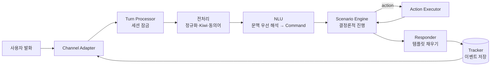

# 챗봇 엔진 코어 — 분석 및 구현 계획 (v2: LLM 없는 시나리오형 코어)

작성: 2026-11-06 · 상태: **초안(결정 대기 1건)**

> 표기: **[확인]** 이번 조사에서 원본(공식 문서·코드·명령 결과)으로 직접 확인 · **[2차]** 블로그·검색 결과 요약 · **[추정]** 실측 전 제안값

---

## 0. 방향과 결정

**확정된 방향 (영기 결정, 2026-11-06)**
- v1 코어에는 **LLM을 쓰지 않는다.** 이해(NLU)·대화 관리·응답을 모두 직접 구현한다.
- 나중에 **빌더**를 만든다. 빌더에서 시나리오와 유사어(동의어·예문)를 등록하고 학습시키면, 챗봇은 시나리오대로 답한다. 코어는 지금부터 이 구조에 맞춰 설계한다.

**남은 결정**

| # | 결정 | 추천 | 대안 | 이유 |
|---|------|------|------|------|
| D1 | 구현 언어 | **Python 3.13+ / FastAPI / Pydantic / scikit-learn / kiwipiepy (uv)** | Kotlin/Spring + Kiwi Java 바인딩 | 한국어 형태소 분석기 Kiwi와 분류기 학습 도구가 Python에서 가장 잘 갖춰져 있다. 머신에 uv·Python이 이미 있다 |

**가정** (틀리면 말해 주세요)
- A1. "LLM 없음"은 **생성형 LLM 없음**이다. 처음에는 신경망 모델도 빼려고 했지만, Phase 0에서 n-gram 방식이 기준(macro-F1 0.90)에 못 미쳐 **문장 임베딩 모델(생성 안 함, 문장 → 벡터)**을 쓰기로 했다 (영기 결정, 2026-11-06).
- A2. 만들 것은 **여러 봇을 올리는 엔진**이다. 기존 기능(날씨·기온·시간·인사 등)은 첫 샘플 봇으로 옮겨 엔진을 검증한다.
- A3. 빌더 UI는 이번 범위가 아니다. 다만 빌더가 쓸 **봇 정의 형식과 학습·배포 API**는 이번 범위에서 정한다.
- A4. 기존 Java 코드는 이 계획이 승인된 뒤 Phase 1에서 지운다. 지금은 손대지 않았다.

---

## 1. 기존 엔진(LASA) 분석

구조: `Listen(전처리) → Analyze(Rasa NLU + KOMORAN 키워드, 결과 병합) → Solve(intent별 switch) → Answer(템플릿)`. 의도를 모르면 OpenAI로 넘긴다.

| 문제 | 근거 (파일:줄) [확인] | 새 엔진에서의 해결 |
|------|----------------------|---------------------|
| 대화 상태가 없다. "부산은?" 같은 후속 질문을 못 받는다 | `ChatRequest.java:30` — `sessionId` 선언만 있고 아무 데서도 읽지 않음 | 세션별 이벤트 기록(Tracker) + 상태 |
| Rasa는 NLU만 쓰고, 학습시킨 대화 관리(stories·rules·TEDPolicy)는 버려진다 | `RasaClientService.java:47` — `/model/parse`만 호출 | 대화 흐름은 시나리오 엔진이 맡음 |
| 두 분석기 결과를 근거 없는 숫자(+0.1, ×0.9, 임계값 0.7)로 합친다 | `HybridAnalyzer.java` `determineIntent` | 분류기 하나 + 봇별로 조정하는 임계값 |
| 지역 인식이 코드에 박힌 키워드 배열이다. 새 지역은 코드를 고쳐야 넣을 수 있다 | `SimpleSolver.java` `LOCATION_KEYWORDS` | 엔티티 사전(대표값 + 동의어)을 봇 데이터로 |
| 업무 로직·응답 문구·사전이 switch문 하나에 섞여 있다 | `SimpleSolver.java` (298줄) | 시나리오(데이터) / 액션(코드) / 응답 템플릿(데이터)으로 분리 |
| 내부 예외 메시지가 사용자에게 그대로 나간다 | `LasaChatbotService.java:67` | 사용자에겐 고정 문구, 상세 내용은 로그에만 |
| 문서와 실제가 다르다 | README는 `/api/v1/chat`, 컨트롤러는 `/api/chat` | API는 OpenAPI 스키마에서 나오고 테스트로 고정 |
| 테스트가 JSON 파싱 1개 + 컨텍스트 로드 1개뿐이다 | `src/test/` | 대화 테스트 + NLU 평가 리포트 |

**재사용할 자산:** `rasaServer/data/nlu.yml`에 의도 10개, 예문 528개가 있다 [확인, `grep -c`]. 이 데이터를 새 형식으로 옮겨 Phase 0의 학습·평가 데이터로 쓴다.

---

## 2. 챗봇 엔진의 원리 — LLM 없는 시나리오형

### 2.1 고전 파이프라인

`발화 → [NLU] 의도 + 엔티티 → [상태 추적] 지금까지 채워진 값 → [정책] 다음 행동 → [응답 생성] 문장` [2차, arXiv 2311.16789]

- 장점: 단계마다 결과를 눈으로 볼 수 있고, 같은 입력엔 항상 같은 답이 나온다.
- 약점: 앞 단계(NLU)의 실수가 뒤로 퍼진다. 예상 밖 문장은 폴백으로 빠진다.
- 대응: 아래 2.3의 "문맥 우선 해석"과 "애매하면 되묻기"로 줄인다.

### 2.2 빌더형 플랫폼들의 공통 구조

| 개념 | 카카오 i 오픈빌더 [2차] | Dialogflow CX [확인] | Amazon Lex V2 [확인] | Rasa NLU [확인, 기존 `config.yml`] | **우리 엔진** |
|------|------|------|------|------|------|
| 의도 | 블록 + 패턴 발화(예문) | intent + training phrase | intent + sample utterance | intent + examples | `Intent` + 예문 |
| 엔티티 | 엔티티(대표 엔트리 + 동의어) | entity type(값 + synonym) | slot type | entity + `EntitySynonymMapper` | `Entity`(대표값 + 동의어 / 정규식 / 시스템) |
| 대화 흐름 | 시나리오 > 블록 | flow > page | intent + slot 되묻기 | stories / rules | `Scenario` > step |
| 값 수집 | 파라미터(필수 시 되묻기) | form parameter | slot elicitation | slot / form | `collect` step |
| 외부 연동 | 스킬(웹훅) | webhook | Lambda | custom action | `Action`(코드 / 나중에 웹훅) |
| 반영 | 학습 후 **배포** | 버전·환경 | version / alias | 모델 학습·로드 | 초안 → 학습 → **배포 버전** |

- 오픈빌더는 동의어로 엔티티를 인식하면 **대표 엔트리를 최종 값으로** 쓴다 [2차, i.kakao.com 엔티티 도움말 검색 결과]. 우리도 같은 규칙을 쓴다. 예: "부싼", "부산광역시" → `부산`.
- 공통점: 봇 개발자는 **데이터(예문·동의어·시나리오·응답)**만 편집하고, 엔진은 그 데이터를 학습·실행한다. 빌더를 붙이려면 코어가 처음부터 이렇게 나뉘어 있어야 한다.

### 2.3 LLM 없는 NLU의 베스트 프랙티스

1. **정규화 → 형태소 분석 → 동의어 치환 → 특징 추출 → 분류.** 기존 Rasa 설정도 글자 단위 n-gram(char_wb 1~4) + 분류기 + 동의어 매퍼 구조였다 [확인, `rasaServer/config.yml`].
2. **특징은 문장 임베딩, 분류기는 LogisticRegression.** 임베딩 모델은 학습시키지 않고(frozen) 그 위에 선형 분류기만 학습한다. 의도당 예문이 10개 안팎일 때 이 방식이 모델 전체를 학습시키는 것보다 정확하고 안정적이다 [확인, Casanueva et al. 2020, arxiv 2003.04807]. Phase 0 실측 결과는 [확인, `docs/benchmarks/phase0.md`]와 같다.
   - `dragonkue/snowflake-arctic-embed-l-v2.0-ko`(600M, Apache-2.0) + LR(C=10)의 결과(hard negative 추가 후): macro-F1 0.933(임계값 교차 적합), 개발용 범위 밖 거절률 0.96 [95% 구간 0.90~0.98], 학습 2.4초. 지연은 연속 요청 p95 15.5ms지만, 요청 사이에 쉬면 p95 약 25~45ms다(쉬는 시간과 측정 회차에 따라 다름, Phase 5 참고).
   - n-gram 최고 조합과의 차이는 +0.103 [부트스트랩 95% 구간 +0.073~+0.143]으로 우연이 아니다. Qwen3-Embedding과의 차이(+0.007 [−0.019~+0.037])는 구분되지 않는다. arctic을 고른 이유는 Qwen3가 지연 기준(p95 24ms)을 넘기 때문이다.
   - 글자·형태소 n-gram은 같은 유사도 게이트를 붙여도 가장 좋은 조합이 F1 0.829, 거절률 0.68에 그쳤다. 단어 조각만 봐서는 "약국 몇 시까지 해?"와 "지금 몇 시야"를 구분하기 어렵다.
   - n-gram을 임베딩에 더해도 나아지지 않았다(0.924). 그래서 v1은 임베딩만 쓴다.
   - **범위 밖 판정은 두 겹이다.** `out_of_scope` 클래스 확률, 그리고 학습 예문(범위 밖 예문 제외)과의 최대 코사인 유사도가 임계값보다 낮은지를 함께 본다. 두 임계값은 교차검증 예측에서만 고른다(hard negative 추가 후: 확률 0.30, 유사도 0.39).
   - 학습할 때 예문 임베딩을 캐시해 두면, 빌더에서 저장할 때 새로 추가된 예문만 임베딩하면 된다.
   - **범위 밖 예문에는 "단어가 겹치는 문장(hard negative)"을 꼭 넣는다.** 의도마다 그 의도의 핵심어 2개를 넣되 다른 것을 묻는 문장을 쓴다("눈이 맑아 보이는 렌즈 추천" ← 날씨의 눈·맑). 근거는 Li, Larson & Leach 2024(arxiv 2403.05640)다. 이런 문장으로 시험하면 Banking77의 AUROC가 0.964에서 0.810으로 떨어지지만, 같은 유형을 학습하면 0.992로 회복된다 [확인]. 우리 독립 테스트에서도 hard 범위 밖 거절률이 0.33에서 0.83으로 올랐다. 학습 문장과 의미가 먼 테스트 문장만 따로 세도 0.33에서 0.82다(n=134) [확인, `docs/benchmarks/phase0b.md`]. 나중에 빌더는 의도를 만들 때 이런 예문을 함께 등록하도록 안내한다.
   - **확신도(0~1)는 LogisticRegression의 `predict_proba`다.** `random_state`를 고정해 같은 데이터면 같은 모델이 나오게 한다. 참고로 LinearSVC는 확률을 내지 않는다. `decision_function`에 softmax를 씌우면 값이 0.2~0.3에 몰려 임계값이 의미가 없어서, Phase 0에서는 sigmoid 보정으로 비교했다.
   - **엔티티 자리 예문(`{location}`) 확장에는 상한을 둔다.** 예문 1개당 무작위 값 3개, 의도당 확장 예문은 원래 예문 수의 2배까지만 만든다. 지역 130개를 모두 넣으면 그 의도만 130배로 불어나 다른 의도와 균형이 깨진다. 교차검증도 **확장 전 원본 예문 단위로 묶어**(GroupKFold) 나눈다. 그래야 거의 같은 문장이 학습용과 평가용에 동시에 들어가 점수가 부풀려지는 일을 막는다.
3. **정확히 일치하는 문장이 먼저다.** 정규화한 입력이 등록된 예문과 똑같으면 분류기를 거치지 않고 그 의도로 정한다(확신도 1.0).
4. **모르면 모른다고 한다.** 확신도가 임계값보다 낮으면 폴백한다. 1위와 2위 점수 차이가 작으면 "혹시 A인가요, B인가요?"처럼 **되묻는다.** 의도와 상관없는 문장을 모은 `out_of_scope` 학습 클래스를 따로 두면 폴백 판단이 좋아진다 [2차, Rasa·Dialogflow 문서의 fallback/negative example 개념].
5. **엔티티는 세 가지 방법으로 뽑는다.**
   - 사전: 대표값 + 동의어. 형태소 단위로, 명사(NNG/NNP) 토큰 전체와 일치할 때만 인정한다. 그래서 "부산스럽다"의 "부산"은 잡히지 않는다.
   - 정규식: 전화번호, 주문번호 등.
   - 시스템 엔티티: 숫자, 날짜("내일", "다음 주 금요일"), 시간.
   - **필요한 엔티티만 채택한다.** 뽑힌 엔티티는 지금 값을 기다리는 slot, 1위 의도 시나리오의 slot, 최근 끝난 시나리오의 slot 중 하나가 받는 타입일 때만 쓴다. 나머지는 기록만 하고 버린다. 동음이의어(예: 시간의 "밤"과 먹는 "밤")로 엉뚱한 값이 들어가는 경우를 여기서 막는다.
6. **문맥을 먼저 본다.** 시나리오가 값을 기다리는 중이면, 의도 분류보다 "그 값이 들어 있는가"를 먼저 확인한다. 예: 봇이 "어느 지역이요?"라고 물었고 사용자가 "부산"이라고 답한 경우.
7. **학습 데이터를 검사한다.** 나중에 빌더가 결과를 그대로 화면에 띄운다.
   - **오류(학습·배포를 막음):** 한 동의어가 두 엔티티 값에 걸침, 같은 예문이 두 의도에 있음
   - **경고:** 예문이 5개 미만인 의도, 다른 의도와 너무 비슷한 예문
8. **의도별로 평가한다.** 교차검증으로 의도별 정밀도·재현율·F1과 혼동 행렬(어떤 의도끼리 헷갈리는지)을 리포트로 남긴다.

### 2.4 형태소 분석기: Kiwi

- kiwipiepy 0.24.1(2026-10-20), Apache-2.0, macOS ARM64 휠 제공 [확인, PyPI].
- 쓸 기능 [확인, GitHub README]:
  - 사용자 사전(`add_user_word`, 기분석 형태 등록) → 빌더에서 등록한 엔티티 값이 쪼개지지 않게 한다.
  - 오타 교정(`typos`)
  - 이형태 통합(`integrate_allomorph`)
- **주의:** README에 "최적화 커널은 x86-64에만 있고 다른 아키텍처는 느릴 수 있다"고 적혀 있다 [확인]. 이 맥북은 ARM64이므로 Phase 0에서 속도를 잰다.

---

## 3. 새 엔진 코어 설계

### 3.1 봇 정의 (빌더가 편집할 데이터)

```yaml
# bots/sample/bot.yaml — 나중엔 빌더가 DB에 저장하고, 같은 구조를 JSON으로 주고받는다
id: sample
settings:
  intent_threshold: 0.6      # [추정] Phase 0에서 조정
  ambiguity_margin: 0.1      # 1위-2위 차이가 이보다 작으면 되묻기
  fallback_response: fallback

intents:
  weather:                   # 키 = 바뀌지 않는 내부 ID (빌더에선 자동 생성)
    label: 날씨 문의          # 화면에 보이는 이름. 이름을 바꿔도 ID는 그대로
    examples: ["오늘 날씨 어때", "{location} 날씨 알려줘", "비 와?"]
  out_of_scope:
    examples: ["주식 추천해줘", "노래 불러줘"]

entities:
  location:
    kind: dictionary
    values:
      부산: ["부산광역시", "부싼"]
      서울: ["서울시", "서울특별시"]
  phone:
    kind: regex
    pattern: "01[016789]-?\\d{3,4}-?\\d{4}"
  # 시스템 엔티티는 선언 없이 사용: sys.number, sys.date, sys.time

scenarios:
  check_weather:
    trigger: { intent: weather }
    slots:
      location: { entity: location, ask: ask_location }
    steps:
      - collect: location
      - action: get_weather              # 코드로 등록된 액션
        args: { location: "{{ slots.location }}" }
      - respond: weather_report

responses:
  ask_location:
    text: "어느 지역 날씨를 알려드릴까요?"
    quick_replies: ["서울", "부산", "제주"]
  weather_report:
    variants:                            # 여러 개면 무작위로 하나를 고름
      - "{{ slots.location }}은 지금 {{ action.weather }}, {{ action.temp }}°C예요."
  fallback:
    text: "잘 이해하지 못했어요. '도움말'이라고 입력해 보세요."
```

- 의도·엔티티·시나리오·응답의 **키는 바뀌지 않는 ID**이고, 사람이 보는 이름은 `label`에 둔다. 이벤트 기록과 세션 상태는 ID만 참조하므로 빌더에서 이름을 바꿔도 깨지지 않는다.
- 예문 안의 `{location}`은 엔티티 자리다. 학습할 때 해당 엔티티의 값으로 채워 예문을 늘린다(상한은 §2.3-2).
- 시나리오 step 종류(v1): `collect`, `action`, `respond`, `branch`(조건 분기), `call`(다른 시나리오 호출).
- slot 타입은 엔티티가 정한다. 사전 엔티티는 대표값, `sys.number`는 숫자, `sys.date`는 ISO 날짜.
- 로드할 때 검증한다. 없는 엔티티·응답·액션을 참조하거나, `call` 호출 관계에 순환이 있으면 로드에 실패한다.
- **배포 단위:** 봇 정의 + 학습된 모델을 묶어 **버전**으로 저장한다. 엔진은 "배포된 버전"만 실행하고, 빌더는 초안을 고친 뒤 학습·배포한다. 모델은 봇·버전별로 따로 저장해 봇끼리 섞이지 않는다.
- **세션은 시작할 때의 버전에 고정한다.** 새 버전을 배포해도 대화 중인 세션은 끝날 때까지(마지막 턴 후 30분) 이전 버전으로 계속 진행하고, 새 세션부터 새 버전을 쓴다. 엔진은 버전을 최근 2개까지 메모리에 둔다. 고정된 버전이 이미 내려갔으면 그 세션을 초기화하고 "대화를 처음부터 다시 시작할게요" 응답을 보낸다. 그래서 삭제된 시나리오를 찾다가 멈추는 일이 없다.

### 3.2 한 턴의 처리 순서



**Turn Processor 알고리즘**

1. `session_id`로 Tracker를 불러오고 세션 잠금을 건다. 같은 세션의 턴은 한 번에 하나씩만 처리하고, 잠금을 못 얻으면 `409`로 거절한다.
2. 입력 검사: 빈 입력이나 길이 초과(예: 1,000자)면 정해진 응답을 보낸다.
3. 전처리: 유니코드 정규화(NFKC), 공백 정리, Kiwi 형태소 분석(사용자 사전 + 오타 교정), 동의어를 대표값으로 치환.
4. NLU가 **Command 목록**을 만든다. 해석 순서는 아래 "문맥 우선 해석"과 같다.
5. Scenario Engine이 Command를 적용하고, 사용자 입력이 필요하거나 시나리오가 끝날 때까지 진행한다. 턴당 최대 20 step(하위 시나리오 포함)이고, 넘으면 중단하고 폴백한다.
6. Responder가 템플릿을 채운다. 변수가 비어 있으면 그 응답 대신 폴백한다.
7. 이번 턴의 이벤트를 **한 트랜잭션으로 저장**한 뒤 응답한다. 저장이 실패하면 오류 응답을 보내고, 그 턴은 없던 것으로 한다.
8. 액션 실패·타임아웃은 `ActionFailed` 이벤트로 남기고, 시나리오에 정의된 실패 응답(없으면 기본 문구)으로 답한다. 예외 메시지는 사용자에게 보내지 않는다.

**문맥 우선 해석 (LLM 없이 대화를 자연스럽게 만드는 핵심)**

| 순서 | 조건 | 결과 Command |
|------|------|--------------|
| 1 | 시스템 의도와 정확히 일치("취소", "처음으로", "도움말") | `CancelScenario` / `Restart` / `StartScenario(help)` |
| 2 | 값을 기다리는 slot이 있고, 입력에서 그 slot의 엔티티가 나옴. 단, 1위 의도가 **진행 중인 시나리오의 trigger와 다른** 의도이고 확신도가 `switch_threshold`(예: 0.8) 이상이면 3으로 | `SetSlot` (같은 시나리오를 다시 시작하지 않음. "날씨 알려줘" → "어느 지역이요?" → "부산 날씨 알려줘"는 slot만 채움) |
| 3 | 의도 확신도 ≥ 임계값, 1·2위 차이 ≥ margin | `StartScenario(trigger 의도)` + 함께 나온 엔티티로 `SetSlot`. 그 시나리오가 이미 스택에 있으면 새로 쌓지 않고 그 프레임에 `SetSlot`만 |
| 4 | 의도는 불확실한데 엔티티만 나왔고, 최근 끝난 시나리오(3턴 이내)에 그 엔티티를 받는 slot이 있음 | 그 시나리오를 새 값으로 **다시 실행** ("부산은?"). 최근 시나리오가 없으면 5·6으로 |
| 5 | 1·2위 차이 < margin | `Clarify([1위, 2위])` → 빠른 답장 버튼으로 되묻기 |
| 6 | 그 외 | `Fallback` |

- 진행 중인 시나리오가 있는데 다른 시나리오가 시작되면 새 시나리오를 위에 쌓는다. 새 시나리오가 끝나면 아래 시나리오로 돌아가 기다리던 질문을 다시 묻는다.
- 같은 slot을 연속 3번 못 채우면 그 시나리오를 취소하고 폴백한다(무한 되묻기 방지).

### 3.3 핵심 타입

```python
Command = StartScenario(id) | SetSlot(name, value) | CancelScenario() | Restart()
        | Clarify(intents) | RerunScenario(id, slot, value) | Fallback()

NluResult(intents: list[(name, score)], entities: list[Entity(type, value, raw, span)],
          tokens: list[Morph], matched_by: "exact" | "classifier" | "context")

Event = SessionStarted(bot_id, bot_version) | UserUttered(text, nlu) | CommandsApplied | SlotSet
      | ScenarioStarted | ScenarioCompleted | ScenarioCancelled
      | ActionExecuted | ActionFailed | BotUttered | TurnFailed

DialogueState(stack: list[ScenarioFrame], slots: dict, last_completed: list[ScenarioRef])
# 상태 = 이벤트를 처음부터 차례로 적용한 결과 (fold)
```

- 모든 턴은 `NluResult`를 이벤트에 남긴다. 빌더의 "대화 로그 → 오인식 문장을 예문으로 추가" 기능이 이 기록을 쓴다.

### 3.4 확장 지점 (Protocol 인터페이스)

| 인터페이스 | v1 구현 | 나중 |
|------------|---------|------|
| `Tokenizer` | Kiwi | — |
| `Featurizer` | 문장 임베딩 `snowflake-arctic-embed-l-v2.0-ko` (MPS fp16) | `Qwen3-Embedding-0.6B`(F1 동급, 범위 밖 거절률 0.99, 다만 p95 24ms) / `multilingual-e5-base`(F1 0.871, p95 9ms) |
| `IntentClassifier` | LogisticRegression(C=10) + 코사인 유사도 범위 밖 게이트 | 다른 모델 / LLM |
| `EntityExtractor` | 사전, 정규식, 시스템(숫자·날짜·시간) | CRF |
| `Action` | Python 함수 + Pydantic 인자 + `StubAction`(테스트) | 웹훅(오픈빌더의 "스킬"과 같은 역할) |
| `TrackerStore` | Postgres, InMemory(테스트) | — |
| `BotRepository` | 파일(YAML) | Postgres(빌더) |
| `Channel` | HTTP JSON, CLI | 메신저 웹훅 |

### 3.5 디렉터리 구조 (제안)

```
pyproject.toml
src/chatcore/
  bot/        schema.py loader.py validate.py version.py
  nlp/        normalize.py tokenizer.py synonyms.py
  nlu/        features.py classifier.py entities/ (dictionary.py regex.py system.py)
              interpreter.py   # 문맥 우선 해석
  train/      dataset.py trainer.py report.py
  dialogue/   events.py state.py commands.py engine.py turn.py
  actions/    registry.py builtin/
  respond/    templates.py
  store/      memory.py postgres.py
  api/        http.py cli.py
bots/sample/  bot.yaml actions.py
tests/        unit/ conversations/ (대화 테스트 YAML)
bench/        phase0.py
compose.yaml  Postgres
Justfile      setup / test / train / chat / eval
```

---

## 4. 실행 스택

| 레이어 | 선택 | 비고 |
|--------|------|------|
| 언어 | Python 3.13+ (uv) | D1 |
| 형태소 | kiwipiepy 0.24.x | ARM64 속도는 Phase 0에서 측정 |
| 분류기 | scikit-learn | 학습 결과는 버전 디렉터리에 저장 |
| 문장 임베딩 | sentence-transformers 6.2 + torch 2.15, 모델 `dragonkue/snowflake-arctic-embed-l-v2.0-ko` | 맥 GPU(MPS) fp16에서 연속 요청 p95 약 15ms, 유휴 후 요청 p95 약 25~45ms. CPU fp32는 연속 46ms, 유휴 후 74ms [확인, 이 세션 실측] |
| API | FastAPI + Pydantic | OpenAPI 자동 생성 |
| 저장소 | Postgres 17 (docker compose) | 세션 이벤트, 나중에 빌더 데이터까지. 테스트는 InMemory |
| 관측 | 구조화 로그(JSON). 턴마다 입력·NLU 상위 3개 의도·엔티티·Command·응답 ID·처리 시간 | OTel은 나중 |

임베딩 모델을 맥 GPU(MPS)로 돌린다. Docker 안에서는 맥 GPU를 못 쓰므로 엔진은 호스트에서 실행한다. 모델 파일은 처음 실행할 때 Hugging Face에서 받는다(약 2GB [추정]).

---

## 5. 구현 단계

단계마다 PR 1개. 완료 조건은 **명령을 실행한 결과로** 판단한다.

### Phase 0 — NLU 데이터·베이스라인 실측 (약 반나절)
1. 최소 uv 프로젝트를 만든다(`pyproject.toml`에 scikit-learn·kiwipiepy). Java 코드는 아직 그대로 둔다.
2. `nlu.yml`의 예문 528개를 새 형식으로 옮긴다. `unknown_location`(12개, "여기/거기 날씨" 같은 지시어 질문)은 지시어가 지역 값이 아니므로 `weather`·`temperature` 예문으로 합친다. 그러면 지역을 되묻는 흐름으로 처리된다. 의도와 상관없는 문장 50개를 `out_of_scope`로 추가한다.
3. `bench/phase0.py`로 비교한다: {확장, 엔티티 토큰 치환} × {글자 n-gram, 형태소 n-gram, 둘 다} × {LogisticRegression, LinearSVC} × C{1, 10}. 비슷한 예문끼리 묶은 단위로 5-fold 교차검증(StratifiedGroupKFold)을 하고 시드 5개로 반복한다. 범위 밖 거절률은 학습에 쓰지 않은 문장 100개로 잰다.
4. 측정 항목: macro-F1, 범위 밖 문장 거절률, 추론 p95 지연, 학습 시간, Kiwi 처리 속도(ARM64).
5. 산출물: 기본 조합, 확신도 계산 방식(§2.3-2), `intent_threshold`·`ambiguity_margin` 초기값.
- **결과 (2026-11-06, 완료):** 독립 리뷰 2회를 반영해 재측정했다(임계값 교차 적합, 의미 기준 묶음, n-gram에도 같은 게이트, 신뢰구간·부트스트랩). arctic 조합 4개가 기준을 넘었고 `expand/emb:arctic/logreg/C10`을 v1 기본값으로 정했다. 데이터 정리 내역(라벨 수정 6건, 삭제 3건 — 두 의도에 겹친 "안녕" 포함, 템플릿 이동 1건, 예문 70개 추가)은 `bench/convert_rasa_nlu.py`와 `bench/data/additions.yaml`에 있다.
- **보강 (Phase 0b, 2026-11-06):** 학습 데이터를 보지 않은 별도 에이전트가 쓴 독립 테스트셋(`bench/data/test_independent.yaml`)으로 미리 정한 4개 구성을 한 번씩만 평가했다(`bench/eval_independent.py` → `docs/benchmarks/phase0b.md`).

  | 구성 | macro-F1 | hard 범위 밖 거절률 | 학습과 먼 문장만: macro-F1 / hard 거절률 |
  |---|---|---|---|
  | 기준 | 0.849 | 0.33 | 0.627 / 0.33 |
  | **+ hard negative 135개 (채택)** | **0.947** | **0.83** | **0.828 / 0.82** |

  - hard negative 학습 문장과 테스트 문장은 같은 방식으로 같은 날 쓰여 소재가 겹치는 쌍이 있다. 그래서 전체 수치는 분포 안 성능이다. 학습 문장과 의미가 먼 문장만 세도 거절률이 0.33에서 0.82로 오르므로, 효과는 겹침 때문이 아니다.
  - **인사/작별 위치 규칙은 채택하지 않는다.** 규칙은 첫 턴이면 greeting 쪽으로, 이후 턴이면 bye 쪽으로 가리고, 상대보다 0.5 이상 높을 때만 뒤집는다. 기본 대화에서는 인사·작별 턴 정확도가 0.875에서 0.958로 올랐다(n=24). 하지만 규칙을 정한 뒤 따로 쓴 경계 대화(`bench/data/test_dialogues_edge.yaml`)에서는 0.833에서 0.800으로 내려갔다. 대화 중간에 다시 인사하는 경우는 0.83에서 0.50이 됐다. 대안 후보는 두 가지다. ① 세션이 30분 쉬면 새 세션으로 보아 첫 턴 규칙을 다시 적용한다. ② 0.5보다 작은 margin을 쓴다. ②는 별도 개발용 대화셋으로 고르고 새 테스트로 검증해야 한다.
  - 이 테스트셋은 이제 열어 봤다. 다음 보강(남은 오답: 체온·냉장고·커피 같은 '온도' 문장)은 새로 쓴 테스트셋으로 재야 한다.
- **완료 조건:** `uv run bench/phase0.py`가 `docs/benchmarks/phase0.md`에 결과표를 쓰고, 아래 기준을 넘은 조합이 있으면 exit 0. 그 조합을 v1 기본값으로 정한다.
  - macro-F1 ≥ 0.90
  - 범위 밖 거절률 ≥ 0.80
  - 추론 p95 ≤ 20ms (연속 요청 기준. 유휴 후 요청은 이 기준을 못 맞춘다는 사실을 Phase 0b에서 발견했다. 아래 Phase 5 참고)
  - 학습 ≤ 10초
  - (모두 [추정] 제안값)

### Phase 1 — 레포 교체·뼈대
1. Java·Gradle·`rasaServer/`를 지운다. 학습 데이터는 Phase 0에서 옮겼고, 지우는 파일 목록은 PR 본문에 첨부한다.
2. Phase 0의 uv 프로젝트에 ruff·mypy(strict)·pytest, GitHub Actions CI를 더한다.
3. `compose.yaml`(Postgres), `Justfile`.
- **완료 조건:** 새로 clone한 디렉터리에서 `just setup && just test`가 통과하고 CI가 초록불.

### Phase 2 — 봇 정의·대화 엔진 (NLU 없이)
1. 봇 정의 스키마·로더·검증(§3.1). 잘못된 참조나 순환이 있으면 로드 실패.
2. 이벤트, 상태(fold), Command, TrackerStore(InMemory·Postgres).
3. Scenario Engine: step 5종, 시나리오 스택, 되묻기 횟수 상한, step 상한.
4. Action 레지스트리 + `StubAction`, Responder(변수 채우기, 무작위 변형, 빠른 답장).
5. Turn Processor + 세션 잠금. NLU 자리에는 `ScriptedInterpreter`(테스트가 Command를 직접 넣음)를 둔다.
- **완료 조건:** 아래 대화 테스트가 pytest로 통과하고, `dialogue/`·`bot/` 커버리지가 90% 이상.
  - "날씨 → 지역 되묻기 → 부산 → 응답"
  - "도중 취소"
  - "도중 다른 시나리오 → 복귀"
  - "3번 실패 → 폴백"

### Phase 3 — NLU 파이프라인·학습
1. 전처리: 정규화, Kiwi(봇 엔티티 값을 사용자 사전에 등록), 동의어 치환.
2. 엔티티 추출: 사전, 정규식, 시스템(숫자·상대 날짜·시간).
3. 분류: Phase 0에서 정한 조합, 정확 일치 우선, 임계값·margin.
4. 문맥 우선 해석기(§3.2 표).
5. `just train bots/sample` 실행 순서: 데이터 검사(경고 출력) → 학습 → 평가 리포트 → 버전 디렉터리에 저장.
- **완료 조건:**
  - 엔티티 추출과 해석기 순서 1~6이 단위 테스트로 통과한다.
  - `just train`이 의도별 F1 리포트를 출력하고, macro-F1이 Phase 0 기준 이상이다.
  - 같은 입력을 두 번 넣으면 같은 결과가 나오는 테스트가 통과한다.

### Phase 4 — 샘플 봇 (기존 기능 이식)
1. 의도: greeting, weather, temperature, time, bye, thanks, help, compliment, negative_feedback + out_of_scope. `unknown_location`은 Phase 0에서 weather·temperature로 합쳤다.
2. 액션: 날씨(키 없는 Open-Meteo API, 테스트는 녹화한 응답 사용), 현재 시각.
3. 지역 엔티티: 기존 `LOCATION_KEYWORDS`를 대표값 + 동의어 사전으로 옮긴다.
- **완료 조건:** `just eval`이 대화 테스트(30개 이상)를 모두 통과하면 exit 0. 여기에는 기존에 안 되던 아래 경우가 포함된다.
  - 후속 질문: "서울 날씨" → "부산은?"
  - 되묻기 후 답하기
  - 애매한 입력에 되묻기

### Phase 5 — 채널·API (여기까지가 "로컬에서 쓸 수 있는 v1")
1. `POST /v1/bots/{bot}/sessions/{id}/messages` → JSON 응답(텍스트 + 빠른 답장 + 디버그용 NLU 결과). CLI 채팅(`just chat`).
2. `POST /v1/nlu/parse`: 문장 하나의 NLU 결과만 돌려준다. 나중에 빌더의 "테스트해 보기"가 쓴다.
3. 턴 단위 구조화 로그.
- **완료 조건:** pytest(httpx) 테스트가 통과한다. 확인 항목은 정상 대화, 빈 입력, 같은 세션 동시 요청 시 409, 없는 봇일 때 404, DB 다운 시 오류 응답이며 예외 메시지가 새지 않아야 한다. `curl`로 로컬 서버와 대화되는 것도 확인한다. 모델 호출은 워커 스레드 하나로 모은다. 여러 스레드가 동시에 MPS를 쓰면 프로세스가 죽을 수 있다(pytorch#197805, 2026-09-23 수정). torch 2.15.0에서는 동기화 없는 4스레드 동시 호출이 3회 모두 살아남았지만 설계는 바꾸지 않는다. 배칭은 '대기 0ms(실행 중 쌓인 요청만 묶음)'로 한다. 측정값은 `docs/benchmarks/concurrency.md`에 있다.
  - 대기 0ms 배칭은 동시 1건 p95 13.0ms로 직렬 처리와 같고, 동시 4건 p95는 31.6ms다.
  - 무작위 도착(초당 120건)에서 p95는 36.1ms로, 대기 2ms 배칭(44.3ms)보다 낫다.
  - **지연 기준(영기 동의, 2026-11-09):** 유휴 후 단일 요청 p95 ≤ 50ms, 동시 4건 p95 ≤ 50ms. 맥은 쉬는 동안 GPU·CPU 클럭을 내려서, 요청 사이에 쉬면 arctic p95가 25~45ms가 된다(0.2초 쉼 25.3~42.5ms, 1초 쉼 43.1~44.7ms, 세 번 측정). 더 작은 모델(e5-small CPU)도 p95 29ms라 20ms는 맞출 수 없다. 사람이 채팅에서 지연을 느끼기 시작하는 건 약 100ms부터라 50ms면 충분하다고 본다 [추정].

### Phase 6 — 빌더 연동 준비
1. `BotRepository` Postgres 구현. 봇 정의를 초안과 배포 버전으로 나눠 저장한다.
2. API: 초안 저장 → 검사 → 학습 → 배포 → 이전 버전으로 되돌리기. 배포하면 엔진이 재시작 없이 새 버전을 쓴다.
3. 대화 로그 조회: 폴백되거나 확신도가 낮았던 문장 목록. 빌더에서 예문으로 추가하는 데 쓴다.
- **완료 조건:** 아래 API 테스트가 모두 통과한다.
  - "예문 추가 → 학습 → 배포 → 같은 문장이 새 의도로 인식됨"
  - "되돌리기 후 원래대로 인식됨"
  - "대화 도중 그 시나리오를 지운 버전을 배포해도, 진행 중인 세션은 이전 버전으로 끝까지 진행됨"
  - "의도 이름(label)을 바꿔도 기존 세션·이벤트가 그대로 동작함"

### 이번 범위에서 뺀 것
빌더 UI, LLM·RAG, 임베딩 모델 미세조정(SetFit 등), 메신저 연동(카카오 등), 다국어, 사용자 인증·멀티테넌시, 리치 카드형 응답. v1이 돈 뒤에 다시 판단한다.

---

## 6. 테스트 전략

| 층 | 무엇을 | 어떻게 |
|----|--------|--------|
| 단위 | 정규화, 엔티티 추출, 해석 순서, 이벤트 fold, 시나리오 step | pytest |
| 대화 | 여러 턴 시나리오 | YAML(사용자 발화 → 기대 응답 ID·slot) → CI에서 항상 실행 |
| NLU 품질 | 의도별 F1, 혼동 행렬, 범위 밖 거절률 | `just train`과 `just eval` 리포트. 기준 미달이면 CI 실패 |
| 통합 | Postgres 저장소, HTTP | compose의 Postgres로 실행 |

각 테스트 파일에는 정상·에러·경계값 케이스를 모두 넣는다. 경계값 예: 빈 입력, 예문 0개인 의도, 동의어 충돌, step 상한 도달.

---

## 7. 위험 요소

| 위험 | 영향 | 대응 |
|------|------|------|
| 의도당 예문이 적다 (빌더 사용자는 5~10개만 넣기 쉬움) | 인식률 저하 | 엔티티 자리 확장, 동의어 치환, 글자 n-gram. 예문이 적은 의도는 학습할 때 경고 |
| 범위 밖 판단이 단어가 겹치는 문장에 약함 | 엉뚱한 시나리오 실행 | hard negative 학습(독립 테스트 거절률 0.33 → 0.83). 남은 약점은 '온도'(체온·냉장고·커피). 다음 후보: 의도별 결정 경계(ADB, Zhang et al. 2021) 또는 기온 관련 hard negative 보강. 새 테스트셋으로 측정 |
| 맥 GPU(MPS)가 없는 환경 | CPU에선 46ms로 지연 예산 초과 | 그 환경에선 `multilingual-e5-base`(CPU 16ms, F1 0.871)로 교체하고 임계값을 다시 보정 |
| greeting↔bye 혼동("안녕"이 두 뜻) | 인사에 작별 답 | 위치 규칙을 시험했으나 대화 중간 재인사를 망가뜨려 채택하지 않음(Phase 0b). 다음 후보: 세션 유휴 시간 기반 재시작, 개발용 대화셋으로 margin 선택 |
| Kiwi가 ARM64에서 느림 [확인: README 경고] | 응답 지연 | Phase 0에서 측정. 느리면 프로세스 내 캐시나 모델 옵션 조정 |
| 한국어 상대 날짜·시간 파싱이 어려움 ("담주 금욜") | 날짜 slot 오인식 | v1은 자주 쓰는 표현 목록 + 테스트로 범위를 고정. 나머지는 되묻기 |
| 문맥 해석 규칙이 늘어나며 서로 충돌 | 예측하기 어려운 동작 | 순서표(§3.2)를 코드의 단일 함수로 두고, 순서마다 대화 테스트를 둠 |

---

## 8. 나중에 LLM을 붙인다면

`IntentClassifier`·`EntityExtractor` 인터페이스 뒤에 구현체를 추가하면 된다. 예를 들어 확신도가 낮을 때만 LLM에 물어보는 방식이다. 시나리오 엔진, 상태, 이벤트는 바뀌지 않는다. 이전 조사 결과(로컬 모델 후보, 24GB 맥의 GPU 메모리 한도 약 16GB)는 그때 다시 확인한다.

---

## 9. 출처

- 고전 대화 시스템 파이프라인 survey: https://arxiv.org/html/2311.16789v2
- 카카오 i 오픈빌더 엔티티(대표 엔트리·동의어): https://i.kakao.com/docs/key-concepts-entity (페이지가 JS로 렌더링되어 본문은 검색 결과 요약으로 확인)
- Dialogflow CX 기본 개념: https://docs.cloud.google.com/dialogflow/cx/docs/basics
- Amazon Lex V2 intent·slot: https://docs.aws.amazon.com/lexv2/latest/dg/how-it-works.html
- Rasa 릴리스 이력(클래식 OSS 유지보수 상태): https://github.com/RasaHQ/rasa/releases
- kiwipiepy: https://pypi.org/project/kiwipiepy/ · https://github.com/bab2min/kiwipiepy
- 기존 Rasa NLU 설정·데이터: `rasaServer/config.yml`, `rasaServer/data/nlu.yml`
